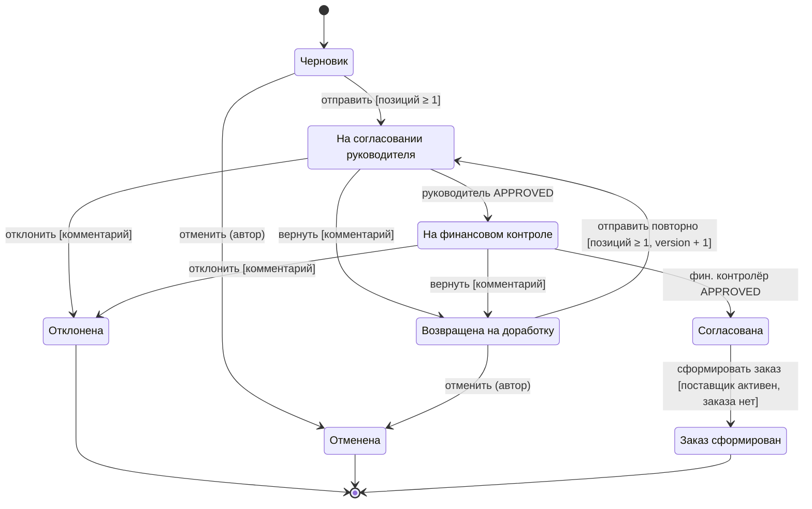
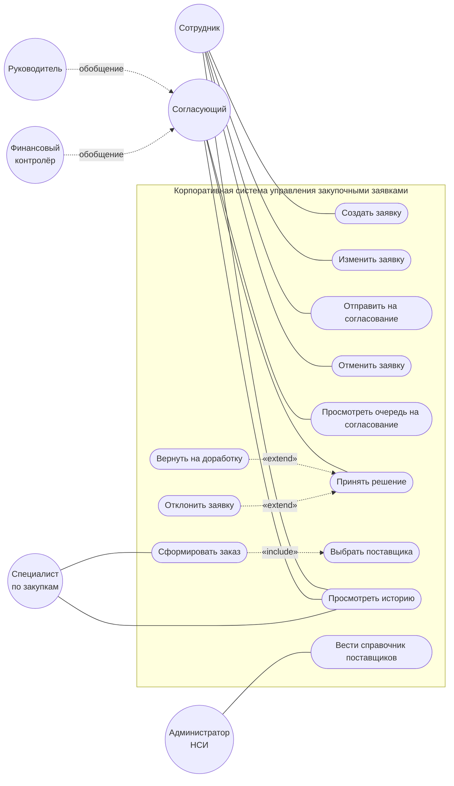
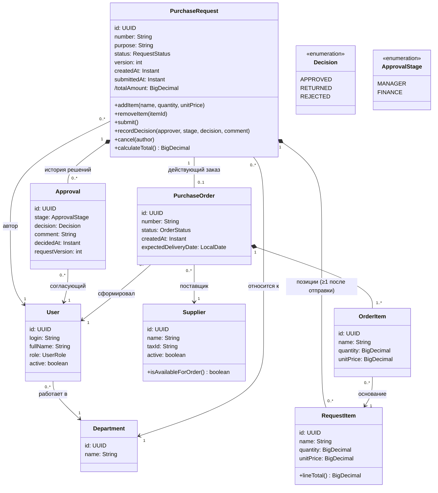

# Практическая работа №1-2. Проектирование КИС управления закупочными заявками

Файлы «Практическая работа №1» и «№2» содержат одно и то же задание (учебное задание с неполной моделью). Ниже — ответы на все пункты в порядке документа.

Фамилия, имя: ______________________ Учебная группа: __________ Дата выполнения: __________

---

## 2. Задание №1. Дополнение неполных требований

| Неполное требование | Формулировка студента |
|---|---|
| После отправки заявки автор больше не имеет права произвольно изменять состав позиций, потому что … | … согласующие принимают решение по конкретному составу и сумме, и изменение после отправки сделало бы уже принятое решение относящимся к другому документу. Изменять позиции можно только в статусах «Черновик» и «Возвращена на доработку». Повторная отправка увеличивает номер версии заявки и запускает согласование заново с первого этапа. |
| При возврате заявки на доработку система обязана сохранить … | … отдельную запись `Approval` с решением RETURNED, этапом согласования, пользователем, временем и непустым комментарием, а также номер версии заявки, к которой относится решение. Предыдущие записи согласования не изменяются и не удаляются. |
| После согласования заявки специалист по закупкам получает право … только при условии … | … выбрать поставщика и сформировать заказ `PurchaseOrder` только при условии, что заявка находится в статусе «Согласована» (для текущей версии есть положительные решения руководителя и финансового контролёра), выбранный поставщик имеет статус «Действующий» на момент сохранения заказа, и для заявки ещё нет действующего заказа. |
| Если поставщик переведён в неактивное состояние, система должна … | … исключить его из списка выбора при формировании новых заказов и отклонить сохранение заказа, если поставщик стал неактивным после выбора (с сообщением «Поставщик N неактивен, выберите другого»). Уже сформированные заказы и история сохраняют ссылку на поставщика без изменений. |
| История согласования должна быть неизменяемой для обычного пользователя, поскольку … | … она служит доказательством того, кто, когда и с каким обоснованием принял решение (аудит, разбор спорных закупок). Исправление ошибочного решения возможно только новой записью. Роли приложения в БД выданы на таблицу `approval` только права `INSERT` и `SELECT`, без `UPDATE`/`DELETE`. |
| Для предотвращения повторного формирования заказа необходимо … | … в одной транзакции заблокировать строку заявки (`SELECT … FOR UPDATE`), проверить статус «Согласована», создать заказ и перевести заявку в «Заказ сформирован». Дополнительно в БД создаётся уникальный частичный индекс `UNIQUE (request_id) WHERE status <> 'CANCELLED'` на `purchase_order`, чтобы второй параллельный запрос получил нарушение ограничения, а не второй заказ. |

## 3. Задание №2. Жизненный цикл заявки

**Достаточен ли базовый набор состояний.** Нет. В процессе два последовательных обязательных этапа согласования, а одно состояние «На согласовании» не показывает, чьё решение ожидается. Кроме того, у автора нет способа отозвать ненужную заявку. Итоговый набор:

`Черновик` → `На согласовании руководителя` → `На финансовом контроле` → `Согласована` → `Заказ сформирован`, плюс `Возвращена на доработку`, `Отклонена` и `Отменена`.

| Текущее состояние | Событие | Следующее состояние | Условие либо комментарий |
|---|---|---|---|
| Черновик | Отправка заявки | На согласовании руководителя | В заявке существует хотя бы одна позиция; количество > 0, цена ≥ 0; фиксируется версия 1 |
| На согласовании руководителя | Положительное решение руководителя | На финансовом контроле | Решение принимает руководитель подразделения заявки; создаётся `Approval(stage=MANAGER, APPROVED)` |
| На финансовом контроле | Положительное решение финансового контролёра | Согласована | Создаётся `Approval(stage=FINANCE, APPROVED)`; оба решения относятся к текущей версии |
| На согласовании руководителя / На финансовом контроле | Возврат на доработку | Возвращена на доработку | Комментарий обязателен |
| Возвращена на доработку | Повторная отправка | На согласовании руководителя | Хотя бы одна позиция; версия увеличивается на 1; согласование начинается с первого этапа, прежние решения остаются в истории |
| На согласовании руководителя / На финансовом контроле | Отрицательное решение | Отклонена | Комментарий обязателен; состояние финальное, дальнейшие переходы запрещены |
| Согласована | Формирование заказа | Заказ сформирован | Поставщик действующий; действующего заказа по заявке нет; выполняется в одной транзакции с созданием `PurchaseOrder` |
| Черновик / Возвращена на доработку | Отмена автором | Отменена | Только автор; финальное состояние |



**Дополнительное бизнес-правило.** Пользователь не может принимать решение по заявке, автором которой он является, и не может согласовать одну и ту же версию заявки на двух этапах (руководитель ≠ автор, финансовый контролёр ≠ руководитель, принявший решение). Правило предотвращает ошибку, когда руководитель подразделения сам создаёт заявку и по невнимательности одобряет её как согласующий. Формально заявка прошла «согласование», но независимой проверки необходимости закупки не было. Система проверяет `approval.approver_id <> request.author_id` в сервисе принятия решения и не показывает такую заявку в очереди этого пользователя.

## 4. Задание №3. Диаграмма вариантов использования

**Ошибочные пунктирные связи и исправления:**

1. **Сотрудник — «Сформировать заказ»** — ошибочна. Заказ формирует специалист по закупкам после завершения согласования, сотрудник не имеет такого права. Связь удалена. Вместо неё у сотрудника ассоциация с «Просмотреть историю» (своих заявок) и новым вариантом «Отменить заявку».
2. **«Принять решение» — Финансовый контролёр** — сама связь по смыслу верна (контролёр принимает решение), но она не должна быть «сомнительной». Она заменена обычной ассоциацией. Чтобы не дублировать линии, введён абстрактный актор **«Согласующий»**, от которого наследуются Руководитель и Финансовый контролёр (обобщение акторов). «Вернуть на доработку» и «Отклонить заявку» связаны с «Принять решение» отношением `«extend»`.
3. **«Функция определяется студентом» — «Актор определяется студентом»** — функция определена как **«Вести справочник поставщиков»** (добавить поставщика, изменить статус «Действующий/Неактивный»), актор — **«Администратор НСИ»**.

Также исправлена сплошная связь Специалист → «Выбрать поставщика» / «Сформировать заказ»: выбор поставщика не имеет смысла отдельно от заказа, поэтому «Сформировать заказ» `«include»` «Выбрать поставщика».

**Недостающий актор.** Нужен — **«Администратор НСИ»** (ведение справочников поставщиков и подразделений, блокировка пользователей). Без него требование «поставщик может участвовать в заказе только при действующем статусе» не имеет исполнителя: никто в модели не меняет статус поставщика. Возлагать это на специалиста по закупкам нельзя: он сам выбирает поставщика и мог бы активировать «удобного», что нарушает разделение обязанностей.

**Добавленные варианты использования:** «Вернуть заявку на доработку» (extend), «Отклонить заявку» (extend), «Отменить заявку», «Вести справочник поставщиков», «Просмотреть очередь заявок на согласование».



**Описание одного варианта использования** — «Сформировать заказ» (полная карточка в п. 5).
Предусловие: заявка «Согласована», заказа нет. Основной сценарий: выбор заявки → выбор активного поставщика → подтверждение → транзакционная проверка и создание заказа. Альтернативный: поставщик стал неактивным / заказ уже создан другим пользователем → отказ без изменения данных. Постусловие: создан один действующий заказ, заявка в статусе «Заказ сформирован».

**Граница автоматизируемой системы.** Внутри системы — всё, что касается заявки как документа и решений по ней. Это создание и изменение заявки и позиций, маршрут согласования и контроль статусов, фиксация решений с комментариями, неизменяемая история, ведение справочника поставщиков и регистрация заказа (номер, поставщик, позиции, связь с заявкой). Вне системы остаются действия, которые система только фиксирует или вообще не видит. Это переговоры с поставщиком и получение коммерческих предложений, проверка бюджета во внешней учётной системе (контролёр смотрит её сам, в нашу систему вносит только решение), подписание договора, оплата, физическая поставка и приёмка товара, бухгалтерский учёт. Отправка заказа поставщику тоже вне границы: система формирует документ заказа, а отправляет его специалист по внешним каналам.

## 5. Карточка варианта использования

| Поле | Содержание |
|---|---|
| Наименование | Сформировать заказ по согласованной заявке |
| Основной актор | Специалист по закупкам |
| Цель актора | Зарегистрировать заказ у действующего поставщика по согласованной заявке, чтобы запустить закупку |
| Предусловия | Пользователь активен и имеет роль «Специалист по закупкам»; заявка в статусе «Согласована» (положительные решения руководителя и финансового контролёра по текущей версии); по заявке нет действующего заказа; в справочнике есть хотя бы один действующий поставщик |
| Триггер | Заявка перешла в статус «Согласована» и появилась в очереди специалиста |
| Основной сценарий | 1. Специалист открывает очередь согласованных заявок. 2. Выбирает заявку; система показывает позиции, итоговую сумму и историю согласования. 3. Специалист выбирает поставщика из списка **только действующих** поставщиков (include «Выбрать поставщика»). 4. Указывает ожидаемый срок поставки и нажимает «Сформировать заказ». 5. Система в одной транзакции блокирует заявку, повторно проверяет её статус «Согласована», действующий статус поставщика и отсутствие действующего заказа. 6. Система создаёт `PurchaseOrder` с уникальным номером, копирует позиции заявки в позиции заказа, переводит заявку в «Заказ сформирован» и записывает событие в журнал (пользователь, время, результат). 7. Система показывает номер заказа. |
| Альтернативный сценарий | 5а. Поставщик был переведён в неактивное состояние после шага 3: транзакция откатывается, система сообщает «Поставщик N неактивен», и сценарий возвращается к шагу 3. 5б. Другой пользователь уже сформировал заказ по этой заявке (срабатывает уникальное ограничение): транзакция откатывается, система показывает номер существующего заказа, и сценарий завершается без создания второго заказа. 5в. Статус заявки изменился (например, она отменена): отказ с указанием текущего статуса. |
| Постусловия | Успех: существует ровно один действующий заказ, связанный с заявкой и действующим поставщиком; заявка в статусе «Заказ сформирован»; в журнале есть запись о действии. Неуспех: данные заявки и справочников не изменены. |
| Связанное бизнес-правило | «Для одной согласованной заявки формируется не более одного действующего заказа» и «Поставщик участвует в заказе только с действующим статусом» |

## 6. Задание №4. Диаграмма классов



**Кратности вместо «?»:**

| Связь | Кратность | Смысл в предметной области |
|---|---|---|
| User — PurchaseRequest («автор ?») | `1` со стороны User, `0..*` со стороны заявки | У каждой заявки ровно один автор, назначенный при создании и не меняющийся; сотрудник может создать сколько угодно заявок или ни одной |
| PurchaseRequest — RequestItem («кратность ?») | `1` — `0..*` (с инвариантом «≥ 1 после отправки») | Позиция принадлежит одной заявке и без неё не существует; черновик может быть пустым, но отправить пустую заявку нельзя. Кратность `1..*` на диаграмме неверна для черновика, поэтому правило вынесено в инвариант |
| PurchaseRequest — Approval («1 к ?») | `1` — `0..*` | По заявке накапливается история решений: до отправки решений нет, при возвратах и повторных отправках их становится больше двух; каждое решение относится ровно к одной заявке |

**Логически неверные связи и исправления:**

1. **Supplier — Approval «поставщик согласует заявку»** неверна: поставщик — внешний контрагент и не участвует в согласовании. Заменена на ассоциацию **PurchaseOrder `0..*` → `1` Supplier**: поставщик выбирается при формировании заказа.
2. **Approval — PurchaseOrder «связь требует проверки»** неверна: заказ создаётся по заявке, а не по отдельному решению. Решений по заявке несколько, и непонятно, к какому из них привязывать заказ. Заменена на **PurchaseRequest `1` — `0..1` PurchaseOrder** (не более одного действующего заказа).
3. **PurchaseOrder — RequestItem «заказ содержит позиции напрямую»** сомнительна: если заказ ссылается на позиции заявки, то их последующее изменение (при частичной поставке, уточнении цены поставщиком) изменит согласованную заявку. Введён класс **OrderItem** (композиция в заказе), который копирует наименование, количество и цену и ссылается на `RequestItem` как на основание.
4. Не хватало связи **Approval → User (согласующий)**: без неё нельзя выполнить требование «однозначно определить пользователя» для решения.

**Добавленные атрибуты и поведение:**
* `User.role`, класс `Department` и связи заявки с подразделением — по условию «заявка относится к одному подразделению».
* `PurchaseRequest.version` и `Approval.requestVersion` — чтобы решение относилось к конкретной версии состава.
* `Approval.stage` — какой этап согласования (руководитель или финансы).
* `RequestItem.lineTotal()` и производный `/totalAmount` — стоимость считается из позиций.
* Методы `PurchaseRequest.submit()`, `recordDecision(...)`, `cancel(...)`, `addItem(...)`/`removeItem(...)` — изменения статуса и состава только через доменные операции с проверкой правил.
* `Supplier.isAvailableForOrder()`.

**Композиция и ассоциация.** Композиция (◆) уместна там, где часть не существует без целого и создаётся и удаляется вместе с ним: `PurchaseRequest ◆ RequestItem`, `PurchaseRequest ◆ Approval` (решение — часть истории конкретной заявки), `PurchaseOrder ◆ OrderItem`. Обычная ассоциация — между самостоятельными сущностями с независимым жизненным циклом: заявка — автор (`User`), заявка — подразделение, заказ — поставщик, заказ — заявка, решение — согласующий. Блокировка пользователя или деактивация поставщика не удаляет заявки и заказы.

**Инвариант класса PurchaseRequest.**
1. Если `status ≠ Черновик` и `status ≠ Отменена`, то `items.size() ≥ 1`, у каждой позиции `quantity > 0` и `unitPrice ≥ 0`.
2. `totalAmount = Σ(item.quantity × item.unitPrice)`.
3. `author` и `department` заданы и не меняются.
4. Если `status ∈ {Согласована, Заказ сформирован}`, то для текущей `version` существуют решения `APPROVED` этапов `MANAGER` и `FINANCE`.
5. Каждое решение `RETURNED`/`REJECTED` имеет непустой комментарий.

Инвариант проверяется в доменных методах класса, а пункты 1, 2 и 5 продублированы ограничениями БД (см. ниже). Поэтому он истинен независимо от того, через какой интерфейс (веб, API, импорт) пришли данные.

**Почему Approval — отдельный объект, а не два поля в PurchaseRequest.** Поля `managerDecision` и `financeDecision` хранят только последнее значение. После возврата и повторной отправки предыдущее решение перезаписывается, и теряются история, комментарий к возврату, автор и время, а именно их по условию нужно хранить без перезаписи. Отдельная запись `Approval` содержит этап, решение, комментарий, согласующего, время и версию заявки. Число решений по заявке не ограничено. Добавление третьего этапа (например, юридической проверки) — новое значение `ApprovalStage`, а не новые столбцы. Записи можно сделать неизменяемыми на уровне БД (только `INSERT`). Текущий статус заявки остаётся полем `status` для быстрых выборок, а `Approval` хранит, как к этому статусу пришли.

## 7. Задание №5. Устранение неоднозначностей

| Исходная формулировка | Исправленная формулировка студента |
|---|---|
| Пользователь может иногда исправлять заявку после отправки. | Автор может изменять позиции и назначение заявки только в статусах «Черновик» и «Возвращена на доработку». В статусах «На согласовании руководителя», «На финансовом контроле», «Согласована», «Отклонена», «Заказ сформирован» операции изменения недоступны, а попытка изменения через API возвращает ошибку 409 «Заявка в статусе X не может быть изменена». |
| Руководитель должен быстро согласовать заявку. | Руководитель принимает решение (согласовать, вернуть, отклонить) не позднее 2 рабочих дней с момента поступления заявки в статус «На согласовании руководителя». По истечении 2 рабочих дней система отправляет руководителю и автору уведомление о просрочке и отмечает заявку в очереди как просроченную. Статус заявки автоматически не меняется. |
| Система должна надёжно хранить историю. | Каждое решение по заявке и каждый переход статуса сохраняется отдельной записью с идентификатором пользователя, временем (UTC, точность до секунды), исходным и новым статусом, решением и комментарием. Записи не изменяются и не удаляются средствами приложения (у роли приложения нет прав UPDATE/DELETE на таблицы истории) и хранятся не менее 5 лет. |
| Заказ создаётся после проверки заявки. | Заказ может создать только пользователь с ролью «Специалист по закупкам» для заявки в статусе «Согласована», то есть при наличии положительных решений руководителя подразделения и финансового контролёра по текущей версии заявки. Создание заказа переводит заявку в статус «Заказ сформирован». |
| Поставщик выбирается из подходящих поставщиков. | При формировании заказа в списке выбора отображаются только поставщики со статусом «Действующий». Действующий статус поставщика повторно проверяется в момент сохранения заказа: если поставщик стал неактивным, заказ не сохраняется и выводится сообщение «Поставщик N неактивен». |

## 8. Проверка согласованности моделей (трассируемость)

| Бизнес-возможность | Use Case | Класс или классы | Контрольное правило | Таблицы БД |
|---|---|---|---|---|
| Создание заявки | Создать заявку | PurchaseRequest, RequestItem, User, Department | Автор и подразделение обязательны; `quantity > 0`, `unit_price ≥ 0` | `purchase_request` (FK `author_id`, `department_id` NOT NULL), `request_item` (CHECK) |
| Отправка на согласование | Отправить на согласование | PurchaseRequest, RequestItem | Нельзя отправить заявку без позиций; переход только из «Черновик»/«Возвращена» | `purchase_request.status`, проверка `EXISTS request_item` в сервисе в транзакции |
| Согласование | Принять решение (+ extend Вернуть / Отклонить) | Approval, PurchaseRequest, User | Решение — новая запись, не перезапись; RETURNED/REJECTED только с комментарием; один APPROVED на этап и версию; согласующий ≠ автор | `approval` (CHECK на комментарий, UNIQUE `(request_id, request_version, stage)`, только INSERT) |
| Формирование заказа | Сформировать заказ (include Выбрать поставщика) | PurchaseOrder, OrderItem, Supplier, PurchaseRequest | Заявка «Согласована»; поставщик действующий; не более одного действующего заказа | `purchase_order` (частичный UNIQUE по `request_id`, FK `supplier_id`), `order_item` |
| Ведение поставщиков | Вести справочник поставщиков | Supplier | Деактивация не удаляет поставщика и не меняет существующие заказы | `supplier.active`, FK без `ON DELETE CASCADE` |
| Аудит | Просмотреть историю | Approval, PurchaseRequest | История неизменяема и упорядочена по времени | `approval` (`decided_at NOT NULL`) |

Фрагмент схемы хранения, на который опираются правила:

```sql
CREATE TABLE approval (
    id              UUID PRIMARY KEY,
    request_id      UUID NOT NULL REFERENCES purchase_request(id),
    request_version INT  NOT NULL,
    stage           VARCHAR(16) NOT NULL CHECK (stage IN ('MANAGER', 'FINANCE')),
    decision        VARCHAR(16) NOT NULL CHECK (decision IN ('APPROVED', 'RETURNED', 'REJECTED')),
    approver_id     UUID NOT NULL REFERENCES app_user(id),
    comment         TEXT,
    decided_at      TIMESTAMPTZ NOT NULL DEFAULT now(),
    CHECK (decision = 'APPROVED' OR length(trim(comment)) > 0)
);
CREATE UNIQUE INDEX ux_approval_once_per_stage
    ON approval (request_id, request_version, stage) WHERE decision = 'APPROVED';

CREATE TABLE purchase_order (
    id          UUID PRIMARY KEY,
    number      VARCHAR(32) NOT NULL UNIQUE,
    request_id  UUID NOT NULL REFERENCES purchase_request(id),
    supplier_id UUID NOT NULL REFERENCES supplier(id),
    status      VARCHAR(16) NOT NULL,
    created_at  TIMESTAMPTZ NOT NULL DEFAULT now()
);
CREATE UNIQUE INDEX ux_one_active_order_per_request
    ON purchase_order (request_id) WHERE status <> 'CANCELLED';

REVOKE UPDATE, DELETE ON approval FROM app_role;
```

## 9. Контрольные ситуации

| Ситуация | Где останавливается ошибка |
|---|---|
| 1. Отправка заявки без позиций | Прикладная логика: `PurchaseRequest.submit()` проверяет `items.size() ≥ 1`; в интерфейсе кнопка «Отправить» недоступна |
| 2. Возврат без комментария | Прикладная логика (валидация решения) + ограничение БД `CHECK (decision = 'APPROVED' OR length(trim(comment)) > 0)` |
| 3. Повторное решение контролёра по уже решённой заявке | Прикладная логика (заявка уже не в статусе «На финансовом контроле») + частичный UNIQUE `(request_id, request_version, stage)` для APPROVED |
| 4. Заказ до завершения согласования | Прикладная логика: проверка статуса «Согласована» внутри транзакции формирования заказа |
| 5. Два почти одновременных заказа по одной заявке | Транзакция + блокировка + ограничение БД |
| 6. Поставщик стал неактивным после выбора | Повторная проверка в транзакции + блокировка строки поставщика |

**Подробно — ситуация 5 (два параллельных заказа).** Проверка в сервисе «заказа ещё нет» сама по себе не спасает: оба запроса выполняют её одновременно, оба видят «нет заказа» и оба вставляют. Поэтому используется сочетание механизмов. (1) Транзакция формирования заказа начинается с `SELECT … FROM purchase_request WHERE id = ? FOR UPDATE`: второй запрос ждёт, пока первый не зафиксирует транзакцию, затем видит статус «Заказ сформирован» и получает понятный отказ. (2) Последний рубеж — частичный уникальный индекс `ux_one_active_order_per_request`. Даже если какой-то путь кода обошёл блокировку (другой сервис, ручной SQL, ошибка разработчика), второй `INSERT` нарушит ограничение. Приложение перехватывает нарушение уникальности и показывает «Заказ по заявке уже сформирован: № …». Правило гарантирует БД, а прикладной уровень делает отказ понятным.

**Подробно — ситуация 2 (возврат без комментария).** Ошибка останавливается на прикладном уровне: сервис принятия решения проверяет, что для RETURNED/REJECTED `comment` не пуст после `trim()`, и возвращает пользователю ошибку валидации до начала транзакции. Интерфейс дополнительно делает поле обязательным при выборе «Вернуть». Ограничение БД `CHECK` дублирует правило, потому что `approval` может заполняться не только из веб-интерфейса (API, миграции, интеграции): запись решения без обоснования физически невозможна. Транзакция здесь не нужна, так как гонки нет — правило касается одной строки.

## 10. Итоговые формулировки студента

**Какая сущность является центральной в разработанной модели и почему.**
Центральная сущность — `PurchaseRequest`. Это агрегат, через который проходит весь процесс: он владеет позициями и историей решений (композиции), хранит текущий статус и версию, к нему привязаны автор, подразделение и итоговый заказ. Все бизнес-правила жизненного цикла (запрет изменения после отправки, обязательные позиции, переходы статусов) реализуются его методами. Остальные классы либо являются его частями (`RequestItem`, `Approval`), либо справочниками (`User`, `Supplier`, `Department`), либо результатом процесса (`PurchaseOrder`).

**Какое бизнес-правило оказалось самым важным для целостности данных и каким механизмом оно обеспечено.**
Правило «для одной согласованной заявки формируется не более одного действующего заказа». Его нарушение приводит к реальным финансовым потерям (двойная закупка), и только его невозможно гарантировать одной проверкой в коде из-за параллельных запросов. Оно обеспечено тремя уровнями: проверкой статуса в сервисе, пессимистической блокировкой строки заявки внутри транзакции и частичным уникальным индексом `UNIQUE (request_id) WHERE status <> 'CANCELLED'` в БД как гарантией последнего уровня.

**Какое исходное решение в неполной модели вы изменили сильнее всего и по какой причине.**
Сильнее всего изменена нижняя часть диаграммы классов: связи вокруг `Approval`, `Supplier` и `PurchaseOrder`. В исходной модели поставщик «согласовывал заявку», заказ был связан с решением, а позиции заказа совпадали с позициями заявки. В итоговой модели поставщик связан только с заказом, заказ — с заявкой (`0..1`), у заказа собственные позиции `OrderItem` со ссылкой на основание. Причина в том, что исходные связи смешивали внутренний процесс согласования с внешним процессом закупки. Из-за этого нельзя было ни гарантировать «не более одного заказа на заявку», ни сохранить согласованный состав неизменным при работе с поставщиком.

**Итоговый вывод.**
В работе восстановлена целостная модель КИС управления закупочными заявками: требования, жизненный цикл, варианты использования, диаграмма классов и схема хранения согласованы между собой и прослеживаются через таблицу трассируемости. Базовый набор состояний был расширен двумя этапами согласования и статусом «Отменена», поскольку одно состояние «На согласовании» не позволяло определить, чьё решение ожидается. История согласования выделена в отдельные неизменяемые записи `Approval` с привязкой к версии заявки: это сохраняет каждое решение с автором, временем и обоснованием при любом числе возвратов. Неверные связи исходной модели (поставщик согласует заявку, заказ связан с решением) заменены связями, отражающими реальный процесс, а на диаграмму вариантов использования добавлены недостающий актор и функции. Ключевые правила целостности защищены на двух уровнях: доменными методами и ограничениями БД, а риск параллельного создания заказов закрыт транзакцией с блокировкой и уникальным индексом. Такое распределение проверок делает модель устойчивой к ошибкам пользователей и к обходу интерфейса.

## 11. Ответы на ключевые вопросы защиты

1. **Почему статус нельзя рассматривать как свободно редактируемую строку?** Статус — результат определённых событий (отправка, решение, заказ), и у каждого перехода есть условия. Свободная строка допускает опечатки («Согласованна») и недопустимые переходы (из «Черновик» сразу в «Заказ сформирован» без решений). Статус — перечисление (`enum` + `CHECK` в БД), изменяемое только доменными методами по таблице переходов.
2. **Почему история согласований отделена от текущего статуса?** Статус отвечает на вопрос «где заявка сейчас», история — «как она сюда попала». Статус меняется и перезаписывается, история только дополняется. При их смешении каждое изменение статуса уничтожало бы сведения о предыдущих решениях, комментариях и их авторах.
3. **Какая ошибка возникнет, если связь заявки и позиций необязательна после отправки?** На согласование уйдёт пустая заявка или заявка, из которой удалили позиции после решения. Итоговая сумма станет 0, и решение будет принято о «ничем». Финансовый контролёр согласует одну сумму, а заказ сформируется на другую.
4. **Какие правила в БД, а какие в сервисном слое?** В БД — правила, касающиеся одной строки или уникальности, которые нельзя нарушать никаким путём: NOT NULL, FK, `CHECK (quantity > 0)`, комментарий при возврате, уникальность действующего заказа и одобрения этапа, запрет UPDATE/DELETE истории. В сервисном слое — правила, зависящие от нескольких сущностей, ролей и процесса: допустимость перехода статуса, «согласующий ≠ автор», наличие позиций при отправке, проверка активности поставщика с понятным сообщением.
5. **Как предотвратить два заказа при параллельных запросах?** Транзакция с `SELECT … FOR UPDATE` строки заявки и проверкой статуса внутри неё, плюс частичный уникальный индекс по `request_id` для действующих заказов. Нарушение ограничения перехватывается и превращается в сообщение «заказ уже сформирован». Альтернатива блокировке — оптимистическая блокировка по полю `version` заявки.
6. **Почему блокировка пользователя не должна разрушать исторические данные?** Его заявки, решения и сформированные заказы — юридически значимые факты. Удаление пользователя каскадно удалило бы историю или оставило «висячие» ссылки. Поэтому пользователь блокируется флагом `active = false`: он не может войти и не появляется в списках выбора, но все ссылки на него сохраняются.
7. **Как бизнес-возможность прослеживается от Use Case до таблиц?** Через таблицу трассируемости (п. 8). Например, «Формирование заказа» — это Use Case «Сформировать заказ», затем классы `PurchaseOrder`/`Supplier`/`PurchaseRequest` и метод формирования заказа в сервисе, затем таблицы `purchase_order`, `order_item` и ограничение `ux_one_active_order_per_request`. Каждое контрольное правило имеет конкретное место реализации.
8. **Как изменится модель при частичных поставках или нескольких поставщиках?** Связь `PurchaseRequest — PurchaseOrder` станет `1 — 0..*`, и уникальный индекс «один заказ на заявку» заменится правилом «сумма заказанного по каждой позиции заявки не превышает согласованного количества». У `OrderItem` появится обязательная ссылка на `RequestItem` и количество, а у заявки — состояния «Частично заказана» / «Полностью заказана». Контроль суммарного количества потребует блокировки позиций заявки в транзакции или отдельной таблицы остатков к заказу.
