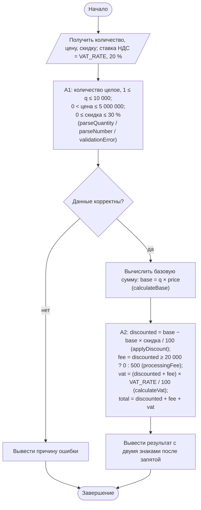
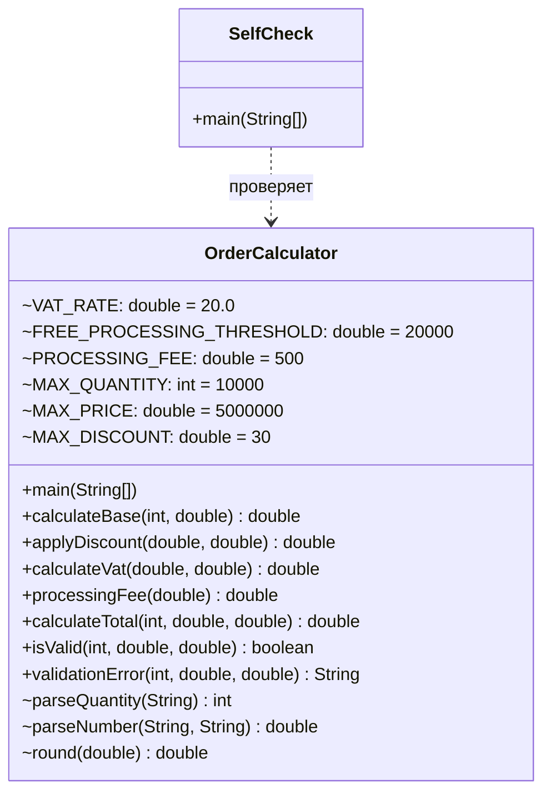

# Практическая работа №3-4. Типы данных, арифметика и корректный расчёт показателей

## Запуск

```bash
javac -encoding UTF-8 -d out src/*.java
java -cp out OrderCalculator   # интерактивный расчёт
java -cp out SelfCheck          # sample.csv + граничные проверки
```

## Индивидуальный вариант

**Вариант 3: порог бесплатной обработки = 20 000 ₽.** Номер варианта: (58 mod 8) + 1 = 3.

Реализованное правило: к заказу добавляется плата за обработку 500 ₽, если сумма **после скидки** меньше 20 000 ₽. При сумме после скидки **≥ 20 000 ₽** (граница включается) обработка бесплатна. Плата за обработку — услуга, поэтому НДС начисляется на «сумма после скидки + обработка».

Порядок расчёта: база → скидка → плата за обработку → НДС → итог.
Порог и размер платы заданы константами `OrderCalculator.FREE_PROCESSING_THRESHOLD` и `PROCESSING_FEE`. Правило сосредоточено в одном методе `processingFee(...)`. Ставка НДС — константа `VAT_RATE` (20 %).

## Activity-диаграмма (итоговая)



## Диаграмма классов (итоговая)



## Выбор типов int и double

* **Количество — `int`.** Это целое число штук в диапазоне 1…10 000. `int` хранит его точно, а ввод «2.5» отклоняется ещё при разборе.
* **Цена, скидка, суммы — `double`.** Так требует диаграмма классов. Максимальная база 10 000 × 5 000 000 = 5·10¹⁰ не помещается в `int` (максимум ≈ 2,1·10⁹). Поэтому умножение выполняется в `double`, так как `price` уже `double`.
* **Ограничение `double`.** Двоичная дробь не может точно хранить десятичные копейки: `3 * 0.1 = 0.30000000000000004`. Ошибки накапливаются, если суммировать, не округляя. В проекте каждая промежуточная сумма (база, скидка, НДС) округляется до копеек методом `round`, а вывод делается через `%.2f`. В промышленном коде для денег используют `BigDecimal` с `RoundingMode.HALF_UP` или хранят суммы в копейках в `long`.

## Анализ фрагмента кода

```java
double total = price * quantity - discount; // discount здесь ошибочно трактуется как абсолютная сумма
```

Ошибка: по правилам работы скидка задаётся **в процентах (0…30)**, а здесь её вычитают как рубли. При цене 1000, количестве 10 и скидке 5 фрагмент даёт 9995 вместо 9500. Кроме того, фрагмент не начисляет плату за обработку и НДС и не округляет до копеек. Ошибка в сумме после скидки сдвигает и проверку порога бесплатной обработки (варианта): заказ может ошибочно попасть по другую сторону от 20 000.
Исправление: `applyDiscount(base, discountPercent)` считает `base − base × discountPercent / 100`, затем `processingFee` сравнивает с порогом именно сумму после скидки, и `calculateVat` начисляет НДС.

## Граничные проверки (результат SelfCheck: 37/37 OK)

| Проверка | Вход | Ожидание | Результат |
|---|---|---|---|
| Корректное типовое значение | 10; 1000; 5 % | 9 500 + обработка 500 + НДС 2 000 = 12 000,00 | OK |
| Нижняя граница | q = 1 / q = 0; цена 0.01 / 0; скидка 0 / −0.01 | допустимо / ошибка | OK |
| Верхняя граница | q = 10 000 / 10 001; цена 5 000 000 / 5 000 000.01; скидка 30 / 30.01 | допустимо / ошибка | OK |
| Порог варианта | после скидки 20 000,00 / 19 999,99 / 19 950 (21 000 − 5 %) | обработка 0 / 500 / 500 | OK |
| Пустое значение | `""` | «количество не указано» | OK |
| Неверный формат | `abc`, `2.5` для количества | контролируемая ошибка | OK |
| Повтор / конфликт данных | в работе нет хранимых сущностей, поэтому повтора нет. Конфликт — ввод «99,90» с запятой: он принимается как 99.90 | число распознано | OK |
| Переполнение | 10 000 × 5 000 000 | 60 000 000 000,00 (без переполнения) | OK |

## Собственные формулировки

**Какая проверка защищает от наиболее вероятной ошибки и где она.** Чаще всего пользователь вводит нечисловое или пустое значение либо выходит за диапазон. Формат проверяется в `parseQuantity`/`parseNumber`: там ловится `NumberFormatException` и превращается в понятное сообщение. Диапазоны проверяет `validationError` до любого расчёта. В `main` расчёт начинается только после того, как обе проверки прошли.

**Где ключевое бизнес-правило и почему.** Порядок «скидка → обработка → НДС» реализован в `applyDiscount`, `processingFee` и `calculateVat`, а собран в `calculateTotal`. Он вынесен в отдельные методы, чтобы формула существовала в одном месте. Её используют и `main`, и `SelfCheck`, поэтому изменение формулы не нужно повторять.

**Как Activity-диаграмма отражает код.** Блок A1 соответствует вызовам `parseQuantity`, `parseNumber` и `validationError` в `main`. Ромб «Данные корректны» — это `if (error != null) { … return; }`. Блок A2 — это вызовы `applyDiscount`, `processingFee` и `calculateVat`, которые идут строго после `calculateBase`.

**Какое изменение затронет минимум классов.** Изменение порога бесплатной обработки, ставки НДС, максимальной скидки или порога количества затрагивает одну константу в `OrderCalculator`. Все проверки и расчёты ссылаются на константы, а не на литералы.
