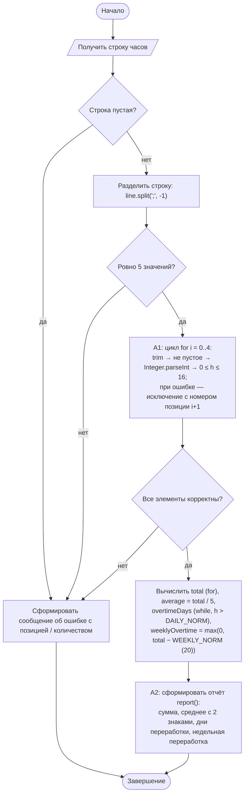
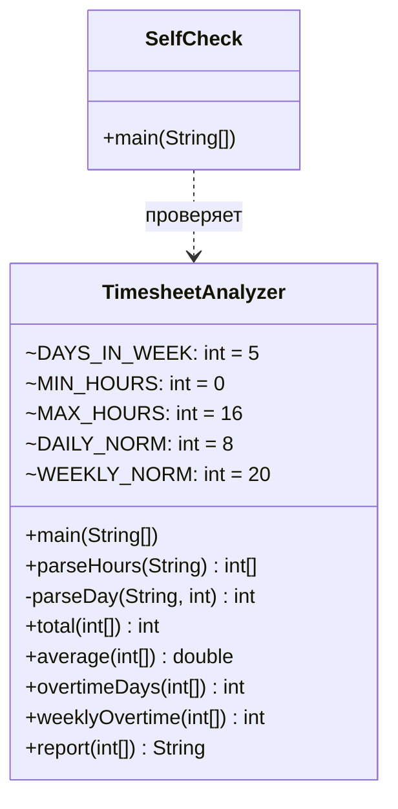

# Практическая работа №5. Строки, массивы, циклы и методы обработки данных

## Запуск

```bash
javac -encoding UTF-8 -d out src/*.java
echo "9;10;11;12;8" | java -cp out TimesheetAnalyzer
java -cp out SelfCheck
```

## Индивидуальный вариант

**Вариант 3: недельная норма = 20 часов** (базовое правило — 40). Номер варианта: (58 mod 8) + 1 = 3.
Правило: недельная переработка = **max(0, сумма − 20)**. Неделя ровно 20 ч — переработки нет, 21 ч — 1 ч переработки. Дневное правило не меняется: день переработки — больше 8 часов.
Норма задана одной константой `TimesheetAnalyzer.WEEKLY_NORM`. Дневная норма 8 (`DAILY_NORM`) и диапазон 0..16 (`MIN_HOURS`/`MAX_HOURS`) тоже вынесены в константы.

## Activity-диаграмма (итоговая)



**Где цикл обработки массива.** Цикл разбора — `for` в `parseHours` (блок A1). Он проходит по массиву строк `parts` и заполняет `int[] hours`. Циклы расчёта — `for` в `total()` и `while` в `overtimeDays()` (блок «Вычислить сумму, среднее и переработку»).

## Диаграмма классов (итоговая)



## Анализ фрагмента кода

```java
for (int i = 0; i <= hours.length; i++) { total += hours[i]; }
```

Ошибка: условие `i <= hours.length` даёт лишнюю итерацию. Для табеля из 5 дней на шаге `i = 5` выполняется `hours[5]`, и программа падает с `ArrayIndexOutOfBoundsException` на **любом** корректном табеле. Последний допустимый индекс — `length − 1`.
Исправление — в методе `total()`: `for (int i = 0; i < hours.length; i++)`.

## Граничные проверки (результат SelfCheck: 29/29 OK)

| Проверка | Вход | Ожидание | Результат |
|---|---|---|---|
| Типовое значение | `4;4;4;4;4` / `8;8;8;8;8` | сумма 20, переработка 0 / сумма 40, недельная переработка 20 | OK |
| Нижняя граница | `0;0;0;0;0` / `-1;8;8;8;8` | допустимо / ошибка «позиция 1» | OK |
| Верхняя граница | `16;16;16;16;16` / `8;8;17;8;8` | 80, 5 дней, 60 ч / ошибка «позиция 3» | OK |
| Граница недельной нормы (вариант) | 19 / 20 / 21 ч за неделю | 0 / 0 / 1 ч переработки | OK |
| Граница дневной нормы | 8 ч / 9 ч в день | не переработка / день переработки | OK |
| Пустое значение | `""`, `8;;8;8;8`, `8;8;8;8;` | «строка пустая», «позиция 2/5: значение отсутствует» | OK |
| Неверный формат | `8;7.5;8;8;8`, `8;8;8;8;abc` | ошибка с позицией | OK |
| Повтор/конфликт | 4 или 6 значений, лишний разделитель | «ожидалось 5 значений, получено N» | OK |

## Собственные формулировки

**Какая проверка защищает от наиболее вероятной ошибки и где она.** Чаще всего ошибаются в структуре строки: пропущено или лишнее значение, двойной `;`. Проверка `parts.length != 5` в `parseHours` стоит сразу после `split(";", -1)`. Флаг `-1` важен: без него `"8;8;8;8;"` молча превратилась бы в 4 значения, и позиция ошибки была бы потеряна.

**Где ключевое бизнес-правило и почему.** Правило «переработка = больше `DAILY_NORM` часов» находится в `overtimeDays()`, правило «max(0, сумма − 20)» (вариант 3) — в `weeklyOvertime()`. Каждое правило — отдельный метод с одной ответственностью. Их можно проверить в `SelfCheck` по отдельности, а изменение нормы не затрагивает разбор строки.

**Как Activity-диаграмма отражает код.** Блок A1 и ромб «Все элементы корректны» — это цикл `for` в `parseHours` и вызов `parseDay(parts[i], i + 1)`. Ветка «нет» — это `throw new IllegalArgumentException("позиция " + position + …)`, которое перехватывается в `main`.

**Какое изменение затронет минимум классов.** Изменение нормы часов, недельной нормы или верхней границы — это одна константа в `TimesheetAnalyzer`. Литералы 8, 16 и 20 в логике не повторяются.
