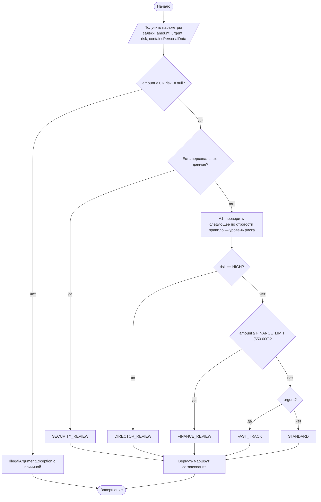
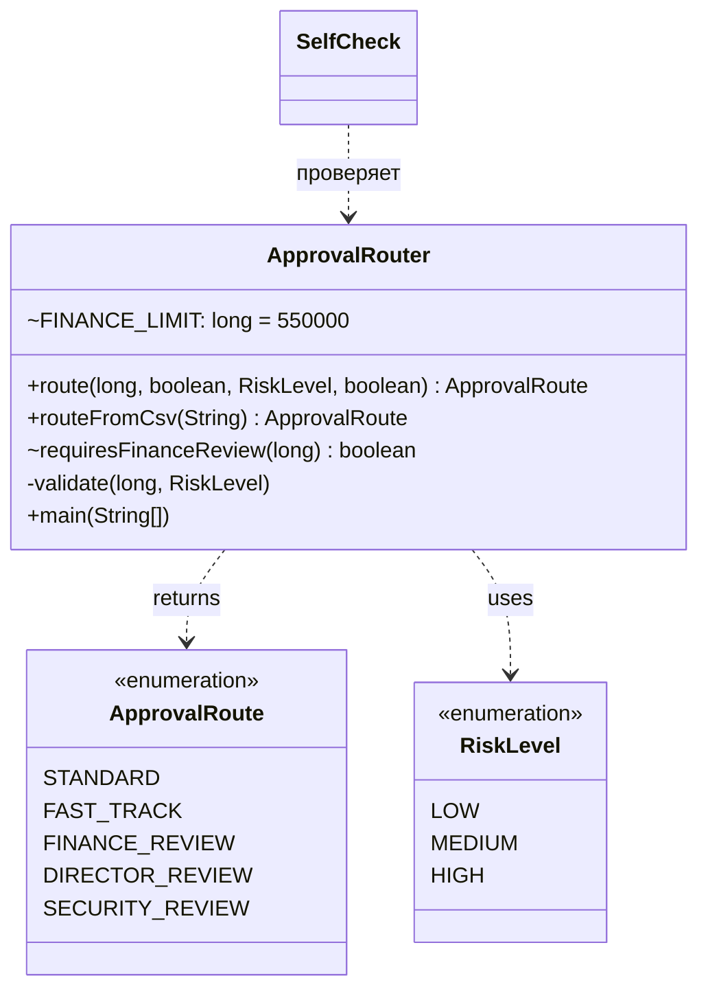

# Практическая работа №6. Логическая задача с ветвлениями и конечным набором решений

## Запуск

```bash
javac -encoding UTF-8 -d out src/*.java
echo "600000;true;LOW;false" | java -cp out ApprovalRouter
java -cp out SelfCheck
```

## Индивидуальный вариант

**Вариант 1: порог финансового согласования, модификатор 10.** Реализованное правило: базовый порог 500 000 ₽ увеличен на 10 %. FINANCE_REVIEW требуется при сумме **≥ 550 000 ₽**, FAST_TRACK возможен при срочной заявке с суммой < 550 000 ₽.
Порог задан одной константой `ApprovalRouter.FINANCE_LIMIT`. Оба правила (FINANCE и FAST_TRACK) используют один метод `requiresFinanceReview`.

## Activity-диаграмма (итоговая)



Каждый ромб — отдельный `if` с `return` в методе `ApprovalRouter.route`, и ромбы идут в том же порядке, что и `if` в коде.

## Диаграмма классов (итоговая)



## Таблица решений (проверяется в SelfCheck)

| № | ПДн | Риск | Сумма | Срочная | Маршрут |
|---|---|---|---|---|---|
| 1 | да | HIGH | 550 001 | да | SECURITY_REVIEW |
| 2 | да | LOW | 1 000 | нет | SECURITY_REVIEW |
| 3 | да | LOW | 1 000 | да | SECURITY_REVIEW |
| 4 | нет | HIGH | 550 000 | нет | DIRECTOR_REVIEW |
| 5 | нет | HIGH | 1 000 | да | DIRECTOR_REVIEW |
| 6 | нет | MEDIUM | 550 000 | да | FINANCE_REVIEW |
| 7 | нет | LOW | 550 001 | нет | FINANCE_REVIEW |
| 8 | нет | LOW | 549 999 | да | FAST_TRACK |
| 9 | нет | MEDIUM | 549 999 | нет | STANDARD |
| 10 | нет | LOW | 0 | нет | STANDARD |

**Точные границы.** Для базового порога 500 000: 499 999 → FAST_TRACK, 500 000 → FINANCE_REVIEW, 500 001 → FINANCE_REVIEW. Для варианта 1 граница сдвинута: 549 999 → FAST_TRACK, 550 000 → FINANCE_REVIEW (условие `>=`, граница входит), 550 001 → FINANCE_REVIEW. В SelfCheck проверены обе тройки. Для варианта 1 сумма 500 000 уже идёт по FAST_TRACK, это ожидаемо.

## Почему порядок `if` влияет на результат

Условия пересекаются: заявка может одновременно быть срочной, содержать ПДн, иметь HIGH-риск и крупную сумму. Метод возвращает маршрут **первого** сработавшего `if`, поэтому порядок проверок и есть приоритет правил. Если поставить слабое правило (срочность) выше сильного (ПДн), сильное правило никогда не будет достигнуто для пересекающихся заявок.

## Анализ фрагмента кода

```java
if (urgent) return FAST_TRACK; if (containsPersonalData) return SECURITY_REVIEW;
```

Ошибка: срочная заявка с персональными данными получит FAST_TRACK и обойдёт обязательную проверку безопасности. А правило гласит: SECURITY_REVIEW нужен «независимо от суммы». Кроме того, фрагмент отправит в FAST_TRACK срочную заявку на 1 000 000 ₽ или с риском HIGH.
Исправление: в `route` проверки идут от строгого к общему: ПДн → HIGH → сумма ≥ порога → срочность → STANDARD (строка 3 таблицы решений).

## Граничные проверки (результат SelfCheck: 31/31 OK)

| Проверка | Вход | Ожидание |
|---|---|---|
| Типовое значение | `120000;false;LOW;false` | STANDARD |
| Нижняя граница | сумма 0 / −1 | STANDARD / ошибка |
| Верхняя граница порога | 549 999 / 550 000 / 550 001 | FAST_TRACK / FINANCE / FINANCE |
| Пустое значение | пустая строка, пустой риск | контролируемая ошибка |
| Неверный формат | `10k`, `maybe`, `CRITICAL`, 5 полей | контролируемая ошибка |
| Конфликт правил | ПДн + HIGH + крупная + срочная | SECURITY_REVIEW (самое строгое) |

## Собственные формулировки

**Какая проверка защищает от наиболее вероятной ошибки и где она.** Самая опасная ошибка — не опечатка ввода, а пересечение правил. Её предотвращает **порядок** проверок в `route()`: первой стоит проверка ПДн. Ошибки ввода (отрицательная сумма, неизвестный риск, не-boolean) ловятся в `validate()` и `routeFromCsv()` до выбора маршрута.

**Где ключевое бизнес-правило и почему.** Все правила маршрутизации собраны в одном методе `ApprovalRouter.route`, чтобы приоритет был виден целиком в одном месте. Если разнести правила по классам, порядок между ними стал бы неявным. Сравнение с порогом вынесено в `requiresFinanceReview`: от него зависят и FINANCE, и FAST_TRACK.

**Как Activity-диаграмма отражает код.** Ромбы «ПДн → HIGH → сумма ≥ порога → срочная» один к одному соответствуют четырём `if` в `route()` и в том же порядке. Блок A1 («определить следующую проверку») — это переход от `if (containsPersonalData)` к `if (risk == HIGH)`.

**Какое изменение затронет минимум классов.** Изменение порога — это одна константа `FINANCE_LIMIT`. Изменение приоритета (например, HIGH выше ПДн) — это перестановка двух `if` в одном методе и строки таблицы в SelfCheck.
