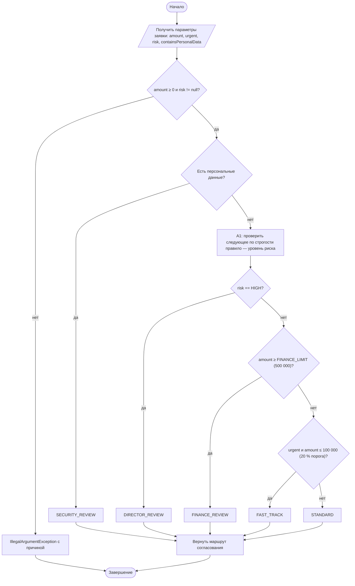
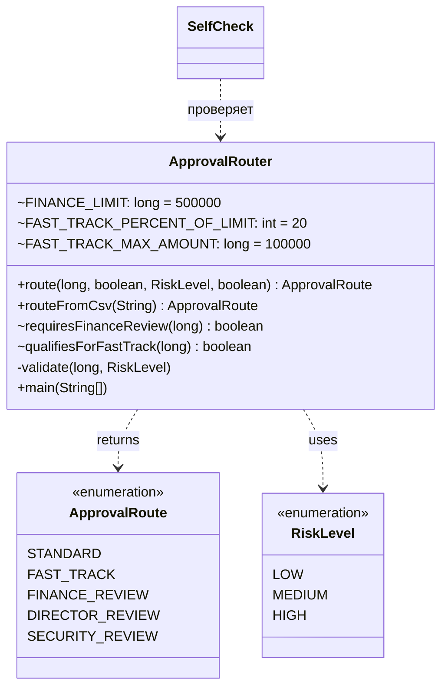

# Практическая работа №6. Логическая задача с ветвлениями и конечным набором решений

## Запуск

```bash
javac -encoding UTF-8 -d out src/*.java
echo "80000;true;LOW;false" | java -cp out ApprovalRouter
java -cp out SelfCheck
```

## Индивидуальный вариант

**Вариант 3: поведение срочной заявки, модификатор 20.** Номер варианта: (58 mod 8) + 1 = 3.
Реализованное правило: срочная заявка получает FAST_TRACK, только если её сумма **не превышает 20 % порога финансового согласования**, то есть **≤ 100 000 ₽**. Срочная заявка на 100 001 … 499 999 ₽ идёт по STANDARD: срочность не даёт ускорения крупным суммам. Заявка ≥ 500 000 ₽ по-прежнему идёт в FINANCE_REVIEW.
Параметры: `ApprovalRouter.FAST_TRACK_PERCENT_OF_LIMIT` (20) и производная от порога `FAST_TRACK_MAX_AMOUNT`. Правило сосредоточено в методе `qualifiesForFastTrack`. Порог финансового согласования — `FINANCE_LIMIT` (500 000), сравнение с ним — в `requiresFinanceReview`.

## Activity-диаграмма (итоговая)



Каждый ромб — отдельный `if` с `return` в методе `ApprovalRouter.route`, и ромбы идут в том же порядке, что и `if` в коде.

## Диаграмма классов (итоговая)



## Таблица решений (проверяется в SelfCheck)

| № | ПДн | Риск | Сумма | Срочная | Маршрут |
|---|---|---|---|---|---|
| 1 | да | HIGH | 500 001 | да | SECURITY_REVIEW |
| 2 | да | LOW | 1 000 | нет | SECURITY_REVIEW |
| 3 | да | LOW | 1 000 | да | SECURITY_REVIEW |
| 4 | нет | HIGH | 500 000 | нет | DIRECTOR_REVIEW |
| 5 | нет | HIGH | 1 000 | да | DIRECTOR_REVIEW |
| 6 | нет | MEDIUM | 500 000 | да | FINANCE_REVIEW |
| 7 | нет | LOW | 500 001 | нет | FINANCE_REVIEW |
| 8 | нет | LOW | 100 000 | да | FAST_TRACK |
| 9 | нет | LOW | 300 000 | да | STANDARD (вариант 3: сумма > 100 000) |
| 10 | нет | MEDIUM | 1 000 | нет | STANDARD |
| 11 | нет | LOW | 0 | нет | STANDARD |

**Точные границы финансового порога:** 499 999 → не FINANCE (срочная — STANDARD, так как больше 100 000), 500 000 → FINANCE_REVIEW (условие `>=`, граница входит), 500 001 → FINANCE_REVIEW.
**Границы варианта 3:** срочная 99 999 → FAST_TRACK, 100 000 → FAST_TRACK (`<=`, граница входит), 100 001 → STANDARD.

## Почему порядок `if` влияет на результат

Условия пересекаются: заявка может одновременно быть срочной, содержать ПДн, иметь HIGH-риск и крупную сумму. Метод возвращает маршрут **первого** сработавшего `if`, поэтому порядок проверок и есть приоритет правил. Если поставить слабое правило (срочность) выше сильного (ПДн), сильное правило никогда не будет достигнуто для пересекающихся заявок.

## Анализ фрагмента кода

```java
if (urgent) return FAST_TRACK; if (containsPersonalData) return SECURITY_REVIEW;
```

Ошибка: срочная заявка с персональными данными получит FAST_TRACK и обойдёт обязательную проверку безопасности. А правило гласит: SECURITY_REVIEW нужен «независимо от суммы». Кроме того, фрагмент отправит в FAST_TRACK срочную заявку на 1 000 000 ₽ или с риском HIGH, а по варианту 3 ускорение положено только суммам до 100 000 ₽.
Исправление: в `route` проверки идут от строгого к общему: ПДн → HIGH → сумма ≥ 500 000 → срочность и сумма ≤ 100 000 → STANDARD (строки 3 и 9 таблицы решений).

## Граничные проверки (результат SelfCheck: 34/34 OK)

| Проверка | Вход | Ожидание |
|---|---|---|
| Типовое значение | `120000;false;LOW;false` / `80000;true;LOW;false` | STANDARD / FAST_TRACK |
| Нижняя граница | сумма 0 / −1 | STANDARD / ошибка |
| Граница финансового порога | 499 999 / 500 000 / 500 001 | STANDARD / FINANCE / FINANCE |
| Граница ускоренного маршрута (вариант) | срочная 99 999 / 100 000 / 100 001 | FAST_TRACK / FAST_TRACK / STANDARD |
| Пустое значение | пустая строка, пустой риск | контролируемая ошибка |
| Неверный формат | `10k`, `maybe`, `CRITICAL`, 5 полей | контролируемая ошибка |
| Конфликт правил | ПДн + HIGH + крупная + срочная | SECURITY_REVIEW (самое строгое) |

## Собственные формулировки

**Какая проверка защищает от наиболее вероятной ошибки и где она.** Самая опасная ошибка — не опечатка ввода, а пересечение правил. Её предотвращает **порядок** проверок в `route()`: первой стоит проверка ПДн. Ошибки ввода (отрицательная сумма, неизвестный риск, не-boolean) ловятся в `validate()` и `routeFromCsv()` до выбора маршрута.

**Где ключевое бизнес-правило и почему.** Все правила маршрутизации собраны в одном методе `ApprovalRouter.route`, чтобы приоритет был виден целиком в одном месте. Если разнести правила по классам, порядок между ними стал бы неявным. Сравнения с порогами вынесены в `requiresFinanceReview` и `qualifiesForFastTrack`, а лимит ускоренного маршрута вычисляется от финансового порога. Поэтому при изменении порога оба правила остаются согласованными.

**Как Activity-диаграмма отражает код.** Ромбы «ПДн → HIGH → сумма ≥ 500 000 → срочная и ≤ 100 000» один к одному соответствуют четырём `if` в `route()` и в том же порядке. Блок A1 («определить следующую проверку») — это переход от `if (containsPersonalData)` к `if (risk == HIGH)`.

**Какое изменение затронет минимум классов.** Изменение доли для ускоренного маршрута — одна константа `FAST_TRACK_PERCENT_OF_LIMIT`, изменение финансового порога — одна константа `FINANCE_LIMIT`. Изменение приоритета (например, HIGH выше ПДн) — это перестановка двух `if` в одном методе и строки таблицы в SelfCheck.
