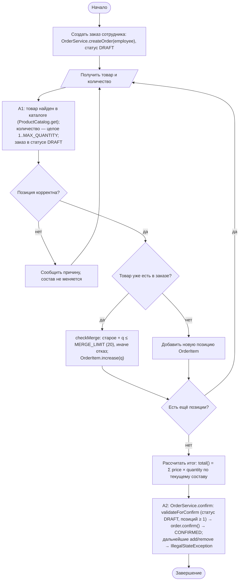
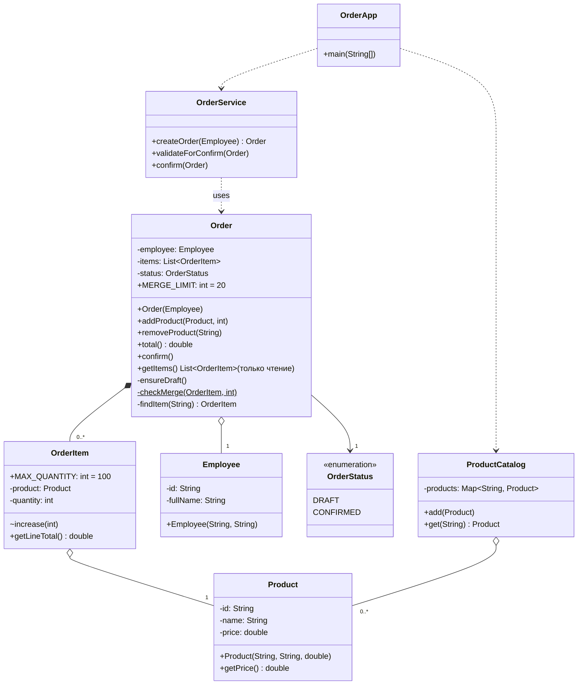

# Практическая работа №7. Первое полноценное ООП-приложение. Корпоративный заказ оборудования

## Запуск

```bash
javac -encoding UTF-8 -d out src/*.java
java -cp out OrderApp     # каталог data/products.csv + команды data/sample.csv
java -cp out SelfCheck
```

Формат `data/sample.csv`: `ADD;productId;quantity`, `REMOVE;productId`, `CONFIRM`. Ошибочная команда не останавливает обработку, а печатается с причиной.

## Индивидуальный вариант

**Вариант 3: правило объединения повторного товара, модификатор 20.** Номер варианта: (58 mod 8) + 1 = 3.
Реализованное правило: если товар уже есть в заказе, повторное добавление объединяется с существующей строкой, только когда итоговое количество **не превышает 20**. Иначе операция отклоняется, а строка не меняется. Первое добавление товара по-прежнему допускает 1…100 штук: крупная партия оформляется одной строкой, а многократные «досыпания» сверх 20 — это, как правило, ошибка (двойное нажатие, повторный импорт).
Параметр: `Order.MERGE_LIMIT`. Правило сосредоточено в методе `Order.checkMerge`. Диапазон количества строки — `OrderItem.MAX_QUANTITY` (100).

## Activity-диаграмма (итоговая)



## Диаграмма классов (итоговая)



Изменения относительно исходной диаграммы:
* Кратность `Order → OrderItem` указана как `0..*`. Черновик может быть пустым, а правило «≥ 1 позиции» проверяется при подтверждении.
* Добавлены `OrderStatus`, `ProductCatalog` (гарантирует уникальность id товара) и `OrderApp` (точка входа). Служебный `Validation` — package-private хелпер для проверки строк, на диаграмме не показан.

## Анализ фрагмента кода

```java
public List<OrderItem> getItems() { return items; } // внешний код получает изменяемую внутреннюю коллекцию
```

Ошибка: внешний код может сделать `order.getItems().clear()` или `add(...)` в обход `addProduct`. Тогда нарушаются все инварианты: заказ меняется после `confirm`, повторный товар появляется второй строкой, количество 500 проходит мимо проверки диапазона.
Исправление: `getItems()` возвращает `Collections.unmodifiableList(items)`. Попытка изменить коллекцию даёт `UnsupportedOperationException`, это проверено в SelfCheck.

## Граничные проверки (результат SelfCheck: 27/27 OK)

| Проверка | Ожидание | Результат |
|---|---|---|
| Типовой заказ 2 × 1000 + 3 × 10.50 | 2031.50 | OK |
| Нижняя граница количества: 0 / 1 | ошибка / OK | OK |
| Нижняя и верхняя граница строки: 0 / 1 / 100 / 101 | ошибка / OK / OK / ошибка | OK |
| Объединение (вариант 3): 15 + 5 = 20 / 15 + 6 = 21 / 50 + 1 | OK / ошибка, строка осталась 15 / ошибка | OK |
| Пустые значения: товар null, пустой id, сотрудник null | IllegalArgumentException | OK |
| Неверный формат: количество `abc`, цена 0 / −1 | контролируемая ошибка | OK |
| Повтор данных: тот же товар дважды; дублирующий id в каталоге | одна строка с суммой количеств; ошибка каталога | OK |
| Изменение после confirm, повторный confirm, пустой confirm | IllegalStateException | OK |

## Собственные формулировки

**Какая проверка защищает от наиболее вероятной ошибки и где она.** Чаще всего пользователь вводит недопустимое количество. Проверка `OrderItem.checkQuantity` вызывается и в конструкторе позиции, и в `increase`. Поэтому ни новая строка, ни объединение не создадут позицию вне диапазона, каким бы путём ни шёл вызов.

**Где ключевое бизнес-правило и почему.** Правила «один товар — одна строка» и «после confirm заказ неизменяем» находятся в `Order` (`addProduct`, `ensureDraft`). Только `Order` владеет списком позиций и статусом. Если правило вынести в сервис, его можно обойти прямым вызовом метода модели.

**Как Activity-диаграмма отражает код.** Ромб «Товар уже есть в заказе» — это `findItem(product.getId())` в `Order.addProduct`. Ветка «да» — `existing.increase(quantity)`, ветка «нет» — `items.add(new OrderItem(...))`. Блок A2 — это `OrderService.confirm` → `validateForConfirm` → `Order.confirm`.

**Какое изменение затронет минимум классов.** Изменение лимита объединения — одна константа `Order.MERGE_LIMIT`, максимального количества строки — одна константа `OrderItem.MAX_QUANTITY`. Изменение самого правила объединения (например, запрет повторного товара вместо суммирования) — только метод `Order.checkMerge`.
