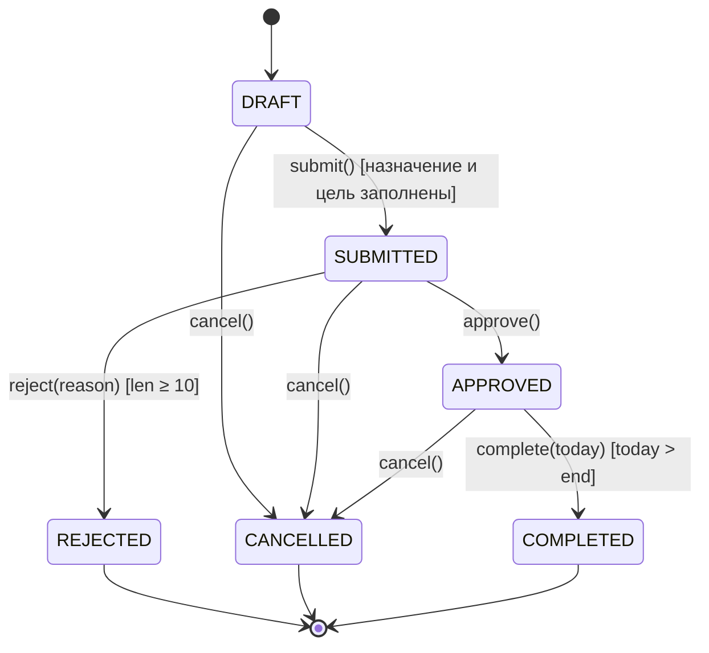
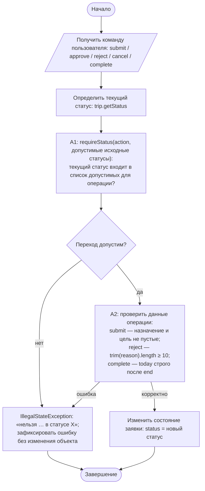
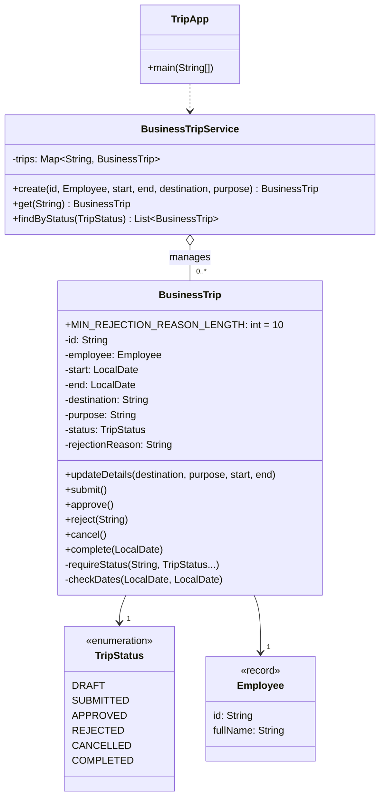

# Практическая работа №8. Инкапсуляция, enum и управление состоянием объекта

## Запуск

```bash
javac -encoding UTF-8 -d out src/*.java
java -cp out TripApp      # сценарий из data/sample.csv
java -cp out SelfCheck
```

## Индивидуальный вариант

**Вариант 1: минимальная длина причины отклонения = 10 символов.** Правило: причина обязательна, длина считается после `trim()`. 9 символов отклоняются, 10 принимаются, строка из одних пробелов отклоняется.
Параметр задан константой `BusinessTrip.MIN_REJECTION_REASON_LENGTH`.

## Таблица переходов состояний

| Из \ операция | submit | approve | reject(reason) | cancel | complete(today) |
|---|---|---|---|---|---|
| **DRAFT** | → SUBMITTED, если заполнены назначение и цель | ✗ | ✗ | → CANCELLED | ✗ |
| **SUBMITTED** | ✗ | → APPROVED | → REJECTED, если причина ≥ 10 симв. | → CANCELLED | ✗ |
| **APPROVED** | ✗ | ✗ | ✗ | → CANCELLED | → COMPLETED, если `today > end` |
| **REJECTED** | ✗ | ✗ | ✗ | ✗ | ✗ |
| **CANCELLED** | ✗ | ✗ | ✗ | ✗ | ✗ |
| **COMPLETED** | ✗ | ✗ | ✗ | ✗ (отмена после завершения запрещена) | ✗ |

✗ — `IllegalStateException`, объект не изменяется. Неверные данные операции (короткая причина, пустое назначение, даты) — `IllegalArgumentException`.



## Activity-диаграмма (итоговая)



## Диаграмма классов (итоговая)



Метод `setStatus` удалён. Изменить статус можно только пятью доменными методами.

## Анализ фрагмента кода

```java
public void setStatus(TripStatus status) { this.status = status; }
```

Ошибка: setter позволяет любому коду перевести заявку из DRAFT сразу в COMPLETED, из COMPLETED обратно в CANCELLED, в REJECTED без причины, в SUBMITTED без назначения. Все правила задания обходятся одной строкой, и объект не может защитить свои инварианты.
Исправление: setter удалён. Каждый переход — отдельный метод (`submit`, `approve`, `reject`, `cancel`, `complete`), который сначала вызывает `requireStatus(...)`, затем проверяет данные и только после этого меняет поле.

## Инварианты, которые защищает BusinessTrip

1. `id` и `employee` заданы и после создания не меняются (`final`).
2. Даты заданы, `end` не раньше `start`.
3. Статус SUBMITTED и дальше — только при заполненных назначении и цели. Данные можно редактировать только в DRAFT.
4. Статус REJECTED ⇔ есть причина длиной ≥ 10 символов.
5. COMPLETED — только из APPROVED и строго после даты окончания.
6. Из финальных состояний (REJECTED, CANCELLED, COMPLETED) переходов нет.
7. При любой ошибке объект остаётся в прежнем состоянии: все проверки выполняются до присваивания.

## Граничные проверки (результат SelfCheck: 28/28 OK)

| Проверка | Ожидание |
|---|---|
| Типовой путь DRAFT → SUBMITTED → APPROVED → COMPLETED | OK |
| Нижняя граница причины: 9 символов / 10 символов | ошибка / принята |
| Граница даты завершения: `today == end` / `end + 1` | ошибка / COMPLETED |
| Однодневная командировка `start == end` / `end < start` | OK / ошибка |
| Пустые значения: причина `null` или из пробелов, пустое назначение | IllegalArgumentException, статус не изменился |
| Неверный формат даты `05.10.2026` | контролируемая ошибка |
| Повтор: повторный id в сервисе, повторный submit/approve | ошибка |
| 11 недопустимых переходов, включая `cancel` после COMPLETED | IllegalStateException |

## Собственные формулировки

**Какая проверка защищает от наиболее вероятной ошибки и где она.** Чаще всего ошибаются, выполняя операцию не в том статусе: повторно нажимают «согласовать» или отменяют уже завершённую командировку. Это закрывает `requireStatus(...)` — первая строка каждого доменного метода `BusinessTrip`.

**Где ключевое бизнес-правило и почему.** Правила переходов находятся в самом `BusinessTrip`, а не в `BusinessTripService`. Статус — поле объекта, и только объект может гарантировать, что поле меняется по правилам. Сервис лишь находит заявку и вызывает доменный метод, поэтому обойти правило через другой сервис нельзя.

**Как Activity-диаграмма отражает код.** Блок A1 — вызов `requireStatus(...)`. Ромб «Переход допустим» — цикл по `allowed` с `return` или `throw IllegalStateException`. Блок A2 — проверки после `requireStatus`: например, в `reject` это `trimmed.length() < MIN_REJECTION_REASON_LENGTH`. Блок «Изменить состояние» — единственная строка `status = …` в конце метода.

**Какое изменение затронет минимум классов.** Изменение минимальной длины причины — одна константа. Изменение правила отмены (например, запретить отмену из APPROVED) — это убрать `TripStatus.APPROVED` из списка в `cancel()`. Затронуты один метод и одна строка таблицы переходов.
