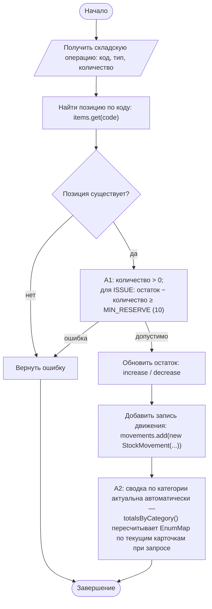
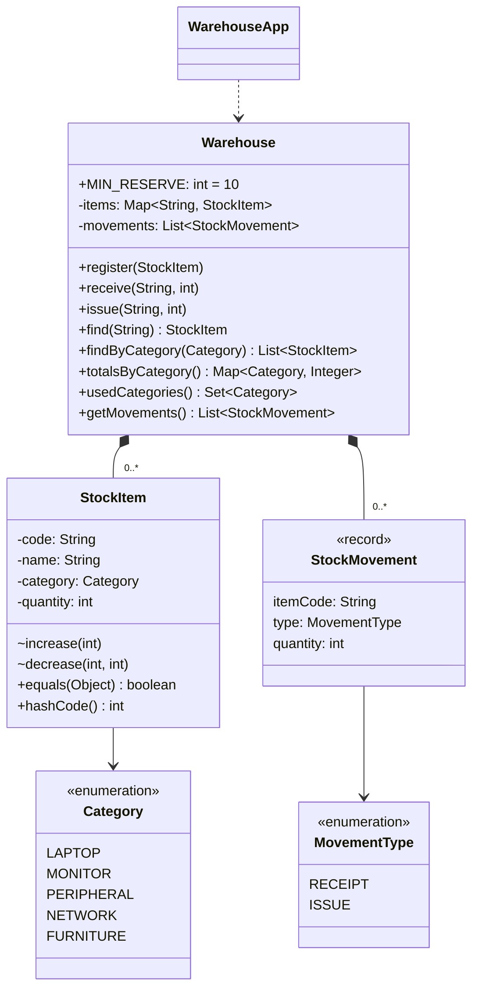

# Практическая работа №9. Коллекции Java и операции над объектами предметной области

## Запуск

```bash
javac -encoding UTF-8 -d out src/*.java
java -cp out WarehouseApp   # сценарий data/sample.csv
java -cp out SelfCheck
```

## Индивидуальный вариант

**Вариант 1: минимальный резерв = 10.** Правило: выдача разрешена, только если после неё остаток позиции **не меньше 10** единиц. Остаток ровно 10 допустим, 9 — нет. Приход резерв не ограничивает.
Параметр задан константой `Warehouse.MIN_RESERVE`. Карточка `StockItem.decrease(amount, minRemaining)` получает его аргументом, поэтому порог хранится в одном месте.

## Выбор коллекций

| Данные | Коллекция | Почему |
|---|---|---|
| Карточки позиций | `Map<String, StockItem>` (`LinkedHashMap`) | Доступ по уникальному инвентарному коду за O(1). Уникальность гарантирует сама структура (`putIfAbsent`). `LinkedHashMap` сохраняет порядок регистрации для стабильного вывода. |
| Журнал операций | `List<StockMovement>` (`ArrayList`) | Операции упорядочены во времени, могут повторяться, к ним обращаются последовательно. |
| Сводка по категориям | `Map<Category, Integer>` (`EnumMap`) | Ключ — enum. `EnumMap` компактна и выдаёт категории в порядке объявления. |
| Перечень используемых категорий | `Set<Category>` (`EnumSet`) | Нужен уникальный перечень без повторов. |

**Когда `List` хуже `Map` в этом кейсе.** Каждая операция `receive`/`issue` начинается с поиска позиции по коду. В `List` это линейный перебор O(n), а уникальность кода пришлось бы проверять тем же перебором перед каждой вставкой. Ошибка в этой проверке даст две карточки с одним кодом и «размазанный» остаток. `Map` решает обе задачи одной операцией.

## Activity-диаграмма (итоговая)



Блок A2 сделан **вычисляемым**, а не отдельно хранимым агрегатом. Так сводка не может разойтись с карточками, если какую-то операцию забыли учесть. На диаграмме это отражено формулировкой A2.

## Диаграмма классов (итоговая)



`equals`/`hashCode` у `StockItem` определены по инвентарному коду: две карточки с одним кодом — один и тот же объект учёта.

## Анализ фрагмента кода

```java
for (StockItem x : items) { if (x.getCode().equals(code)) return x; } // при наличии Map поиск линейным циклом избыточен
```

Ошибка: склад уже хранит позиции в `Map<String, StockItem>` с ключом-кодом, а фрагмент ищет перебором. Он тратит O(n) вместо O(1), дублирует назначение ключа Map и молча возвращает «первую попавшуюся», если коллекция когда-нибудь допустит дубликаты.
Исправление: `Warehouse.find(code)` — это `items.get(code.trim())` плюс понятная ошибка, если позиции нет.

## Граничные проверки (результат SelfCheck: 25/25 OK)

| Проверка | Ожидание |
|---|---|
| Типовая выдача 25 − 5 | остаток 20 |
| Граница резерва: выдача до остатка 10 / до 9 | OK / IllegalStateException, остаток не изменился |
| Нижняя граница количества: 0, −3 | IllegalArgumentException |
| Пустые значения: код `null`, пустой код, категория `null` | контролируемая ошибка |
| Неверный формат: категория `KITCHEN`, количество `abc` | контролируемая ошибка |
| Повтор: повторный инвентарный код | отказ, исходная карточка сохранена |
| Изоляция: `clear()` результата поиска, изменение сводки, `getMovements().clear()` | склад не меняется / UnsupportedOperationException |

## Собственные формулировки

**Какая проверка защищает от наиболее вероятной ошибки и где она.** Чаще всего пытаются выдать больше, чем есть. `StockItem.decrease` сравнивает `quantity − amount` с резервом **до** изменения поля. Остаток никогда не становится ниже резерва (а значит, и отрицательным), а неуспешная операция не попадает в журнал.

**Где ключевое бизнес-правило и почему.** Уникальность кода находится в `Warehouse.register` (`putIfAbsent`), потому что только склад видит все карточки. Правило неотрицательного остатка — в `StockItem.decrease`, потому что остаток — поле карточки. Значение резерва — в `Warehouse.MIN_RESERVE`: это политика склада, а не свойство отдельной позиции.

**Как Activity-диаграмма отражает код.** «Найти позицию по коду» и ромб «Позиция существует» — это `Warehouse.find`. A1 — это `requirePositive` и сравнение с `minRemaining` в `StockItem.decrease`. «Добавить запись движения» — `movements.add(...)` в `issue`/`receive`, он выполняется только после успешного изменения остатка.

**Какое изменение затронет минимум классов.** Изменение резерва — одна константа. Новая категория — одна строка в `enum Category`: `EnumMap`/`EnumSet` подхватят её автоматически.
