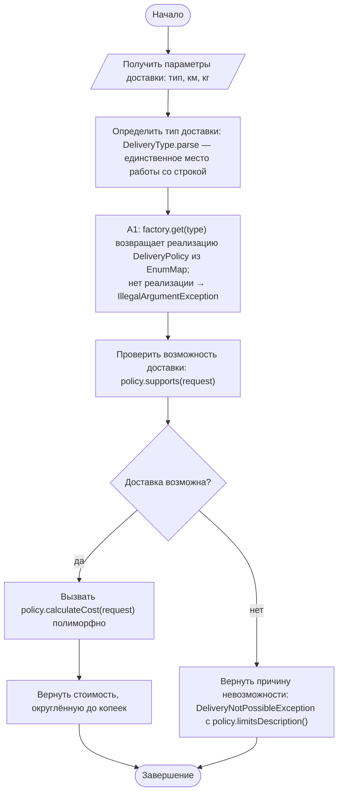
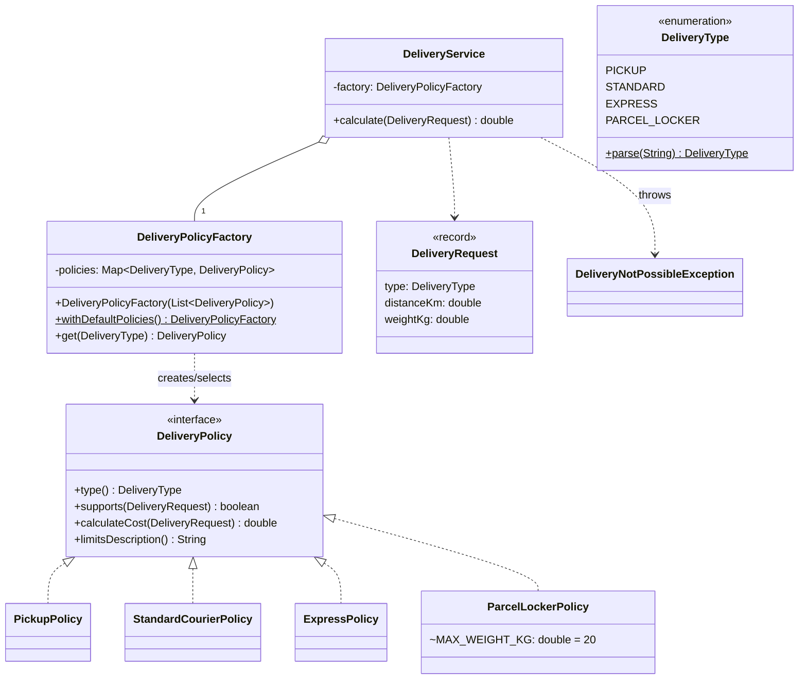

# Практическая работа №10. Интерфейсы, полиморфизм и замена условной логики

## Запуск

```bash
javac -encoding UTF-8 -d out src/*.java
java -cp out DeliveryApp   # расчёт для каждой строки data/sample.csv (type;distanceKm;weightKg)
java -cp out SelfCheck
```

## Тарифы

| Способ | Класс | Формула | Ограничения |
|---|---|---|---|
| Самовывоз | `PickupPolicy` | 0 | вес ≤ 50 кг |
| Стандартный курьер | `StandardCourierPolicy` | 300 + 20 × км + 15 × (вес − 5)⁺ | ≤ 100 км, ≤ 30 кг |
| Экспресс | `ExpressPolicy` | max(800, 500 + 40 × км) | ≤ 50 км, ≤ 10 кг |
| **Постамат (вариант 3)** | `ParcelLockerPolicy` | 250 + 10 × кг | ≤ **20 кг**, ≤ 30 км |

## Индивидуальный вариант

**Вариант 3: ограничение по весу = 20 кг.** Номер варианта: (58 mod 8) + 1 = 3.
Добавлен четвёртый способ PARCEL_LOCKER — доставка в постамат, ячейка которого ограничивает вес: посылка **до 20 кг включительно**. 20 кг — расчёт, 20.01 кг — `DeliveryNotPossibleException`. Константа: `ParcelLockerPolicy.MAX_WEIGHT_KG`.
Для добавления понадобились новый класс `ParcelLockerPolicy`, константа `PARCEL_LOCKER` в `DeliveryType` и одна строка регистрации в `DeliveryPolicyFactory.withDefaultPolicies()`. Ни `DeliveryService`, ни три существующие политики не менялись.

## Activity-диаграмма (итоговая)



## Диаграмма классов (итоговая)



## Анализ фрагмента кода

```java
if (type == EXPRESS) { ... } else if (type == STANDARD) { ... } else if (type == PICKUP) { ... }
```

Ошибка: все формулы и ограничения живут в одном методе сервиса. Чтобы добавить четвёртый способ, нужно править этот метод, рискуя сломать уже работающие расчёты. Забытая ветка не замечается компилятором, а тест одного тарифа требует подготовки всего сервиса. Такие же цепочки обычно повторяются для `supports`.
Исправление: каждая ветка вынесена в класс-реализацию `DeliveryPolicy`. `DeliveryService.calculate` делает два полиморфных вызова (`supports`, `calculateCost`) без единого `if` по типу.

## Отличие полиморфизма от `switch` по enum

`switch` по enum всё ещё собирает знание обо всех способах в одном месте. Каждая новая операция (стоимость, ограничения, описание) — это ещё один `switch`, который нужно найти и дополнить. При полиморфизме знание о способе собрано в его классе: данные, формула и ограничения рядом. Сервис зависит только от интерфейса. Новый способ добавляется **новым** классом, а существующий код не меняется (принцип открытости/закрытости). Enum `DeliveryType` остался только ключом выбора в фабрике.

## Граничные проверки (результат SelfCheck: 26/26 OK)

| Проверка | Ожидание |
|---|---|
| Типовое значение: стандарт 10 км, 3 кг | 500,00 |
| Нижние границы: 5 кг без доплаты; самовывоз 0 км | 300,00; 0,00 |
| Верхние границы: стандарт 100 км и 30 кг / 100.1 км; экспресс 10 кг / 10.01 кг; постамат 20 кг / 20.01 кг (вариант 3) и 30 км / 30.1 км | расчёт / отказ |
| Пустые значения: пустой тип, тип `null` | IllegalArgumentException |
| Неверный формат: `DRONE`, расстояние `abc`, вес 0, расстояние −1 | IllegalArgumentException |
| Конфликт: две политики одного типа в фабрике; нет политики для типа | IllegalArgumentException |

## Собственные формулировки

**Какая проверка защищает от наиболее вероятной ошибки и где она.** Самая частая ошибка — тип доставки строкой с опечаткой или в другом регистре. `DeliveryType.parse` нормализует регистр и даёт понятное сообщение. После этой точки код работает только с enum и объектами-политиками, а строки в расчёте больше не участвуют.

**Где ключевое бизнес-правило и почему.** Каждая формула и её ограничения находятся в своей реализации `DeliveryPolicy`. Это правило одного конкретного способа доставки, и оно должно меняться независимо от остальных. Общее правило «сначала supports, потом calculateCost» находится в `DeliveryService`.

**Как Activity-диаграмма отражает код.** A1 — `factory.get(request.type())`. Ромб «Доставка возможна» — `if (!policy.supports(request)) throw new DeliveryNotPossibleException(...)`. «Вызвать calculateCost полиморфно» — `policy.calculateCost(request)`: конкретный метод выбирается во время выполнения по классу объекта.

**Какое изменение затронет минимум классов.** Изменение ограничения одного способа (например, веса для постамата в варианте) затрагивает только его класс-политику. Новый способ — новый класс + константа enum + одна строка регистрации.
