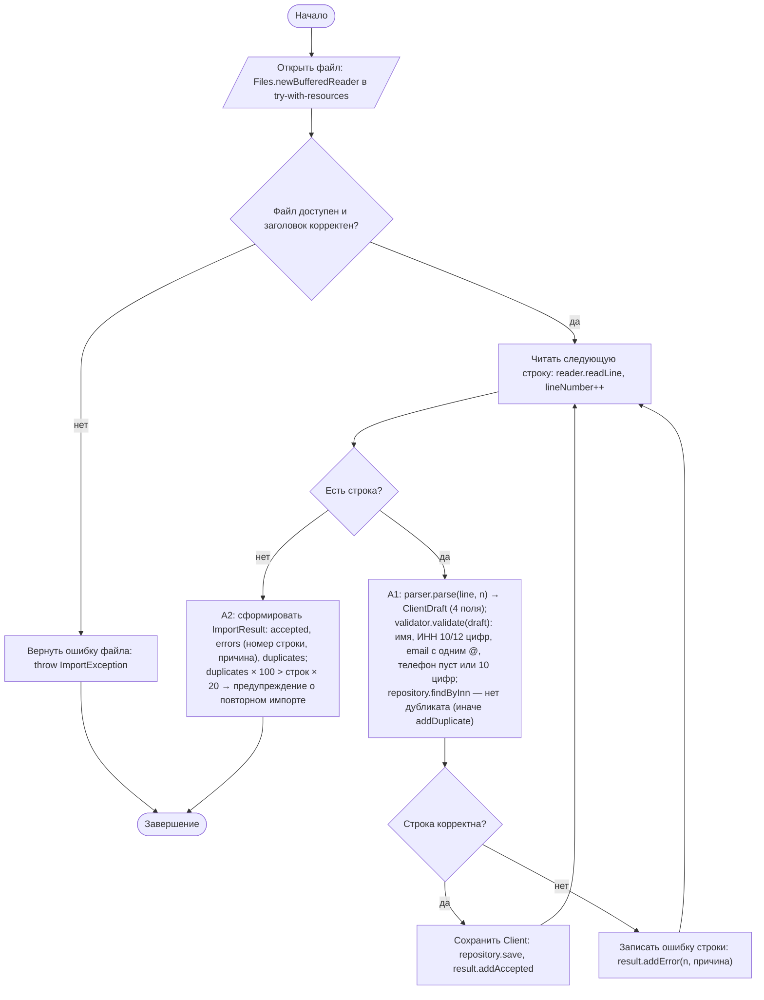
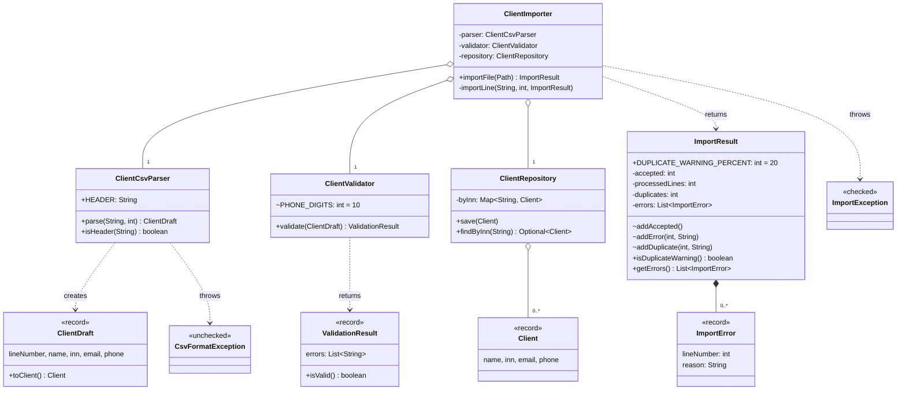

# Практическая работа №11. Файлы, исключения и устойчивый пакетный импорт

## Запуск

```bash
javac -encoding UTF-8 -d out src/*.java
java -cp out ImportApp                    # импорт data/sample.csv
java -cp out ImportApp data/test/empty.csv     # ошибка уровня файла
java -cp out ImportApp data/test/reimport.csv  # предупреждение о дубликатах (вариант 3)
java -cp out SelfCheck
```

Формат файла: первая строка — заголовок `name;inn;email;phone`, разделитель `;`, кодировка UTF-8. Пустые строки пропускаются.

## Индивидуальный вариант

**Вариант 3: политика дубликатов, модификатор 20.** Номер варианта: (58 mod 8) + 1 = 3.
Реализованное правило:
1. Первая запись с ИНН принимается. Все последующие строки с тем же ИНН отклоняются как ошибка строки с сообщением «дубликат ИНН … (уже импортирован клиент '…')». Существующий клиент не перезаписывается.
2. Если отклонённых дубликатов **больше 20 %** обработанных строк данных, `ImportResult` получает предупреждение «вероятно, файл уже импортировался». Ровно 20 % предупреждения не даёт. Импорт при этом **не прерывается**, как требует правило «ошибка строки → импорт продолжается».

Параметр: `ImportResult.DUPLICATE_WARNING_PERCENT`. Повторы учитываются методом `ImportResult.addDuplicate`, решение о предупреждении принимает `isDuplicateWarning()`.

Телефон — необязательное поле. Если он указан, в нём должно быть ровно 10 цифр номера (пробелы, скобки, дефисы, `+7`/`8` в начале допускаются). Сохраняется нормализованным (`9161234567`).

## Почему `Files.newBufferedReader`, а не `Files.readAllLines`

`newBufferedReader` читает файл построчно: в памяти одна строка, а не весь файл. Импорт из выгрузки на сотни тысяч клиентов не упрётся в память. Номер строки считается вместе с чтением, а `try-with-resources` гарантированно закрывает файл и при исключении. `readAllLines` проще, но загружает весь файл целиком. Для пакетного импорта, где размер файла заранее неизвестен, это хуже.

## Разделение ошибок

| Уровень | Примеры | Механизм | Поведение |
|---|---|---|---|
| Файл | нет файла, нет прав, пустой файл, неверный заголовок | проверяемое `ImportException` (обёртка над `IOException`) | импорт прекращается целиком, метод объявляет `throws ImportException`, вызывающий обязан обработать |
| Структура строки | не 4 поля | непроверяемое `CsvFormatException` от парсера, перехватывается **только** в `importLine` | ошибка строки → `ImportResult`, цикл продолжается |
| Данные строки | ИНН, email, телефон, пустое имя | `ValidationResult` (без исключений, собираются **все** ошибки строки) | ошибка строки → `ImportResult` |
| Конфликт | дубликат ИНН | проверка `repository.findByInn` | ошибка строки → `ImportResult.addDuplicate`; при доле > 20 % — предупреждение |

Общего `catch` на весь цикл нет: обработка одной строки вынесена в `importLine`, и её ошибки не выходят за пределы метода.

## Activity-диаграмма (итоговая)



## Диаграмма классов (итоговая)



## Анализ фрагмента кода

```java
try { for (String line : lines) importLine(line); } catch (Exception e) { return; } // первая плохая строка останавливает весь импорт
```

Ошибки:
1. `try` охватывает весь цикл, поэтому первое исключение в любой строке прерывает обработку **всех** следующих строк. Это прямо нарушает правило «ошибка строки записывается, импорт продолжается».
2. `catch (Exception e) { return; }` молча глотает ошибку: нет ни номера строки, ни причины, ни отчёта о принятых записях.
3. Ошибка файла и ошибка строки неразличимы.

Исправление: в `ClientImporter` перехват находится внутри обработки одной строки (`importLine`), ловится конкретный `CsvFormatException`, а ошибки валидации возвращаются значением. Ошибки файла пробрасываются наружу как проверяемое `ImportException`.

## Граничные проверки (результат SelfCheck: 29/29 OK)

| Проверка | Вход | Ожидание |
|---|---|---|
| Типовое значение | `data/sample.csv` | принято 4, отклонено 7 (1 дубликат из 11 строк — без предупреждения), у каждой ошибки номер строки |
| Нижняя/верхняя граница ИНН | 9 / 10 / 11 / 12 / 13 цифр | ошибка / OK / ошибка / OK / ошибка |
| Граница телефона | 9 цифр / 10 цифр / +7 и 11 цифр / пустой | ошибка / OK / OK (нормализован) / OK |
| Пустое значение | пустое имя, пустой файл, только заголовок | ошибка строки / ImportException / 0 и 0 |
| Неверный формат | email `alfa.ru`, `a@@b.ru`, `@b.ru`; 3 поля в строке; неверный заголовок | ошибка строки / ошибка строки / ImportException |
| Повтор | ИНН 7701234567 дважды | вторая строка отклонена, первый клиент сохранён |
| Доля дубликатов (вариант 3) | `data/test/reimport.csv`: 2 из 5 (40 %) / `duplicates_20pct.csv`: 1 из 5 (ровно 20 %) | предупреждение, импорт завершён / без предупреждения |
| Файл отсутствует | `no_such_file.csv` | ImportException, импорт прерван |

## Собственные формулировки

**Какая проверка защищает от наиболее вероятной ошибки и где она.** В реальных выгрузках чаще всего встречаются «битые» строки: не хватает поля или лишний `;`. Проверку `p.length != FIELD_COUNT` в `ClientCsvParser.parse` дополняет перехват `CsvFormatException` в `importLine`. Благодаря этому одна такая строка не роняет весь импорт.

**Где ключевое бизнес-правило и почему.** Правило «ошибка строки не останавливает импорт» реализовано в `ClientImporter.importLine`. Только импортёр координирует чтение, разбор, валидацию и сохранение. Правила корректности полей (ИНН, email, телефон) — в `ClientValidator`, отдельно от чтения файла. Их можно проверить без файлов.

**Как Activity-диаграмма отражает код.** Цикл «Читать следующую строку → Есть строка» — это `while ((line = reader.readLine()) != null)`. Обе ветки «Сохранить Client» и «Записать ошибку строки» возвращаются к чтению: в коде `importLine` завершается `return` после `addError`, и цикл `while` продолжается.

**Какое изменение затронет минимум классов.** Новое правило поля (например, длина имени) затрагивает только `ClientValidator`. Изменение порога предупреждения о дубликатах — одна константа `ImportResult.DUPLICATE_WARNING_PERCENT`. Смена самой политики (например, «последняя запись побеждает») — одна ветка в `importLine`.
