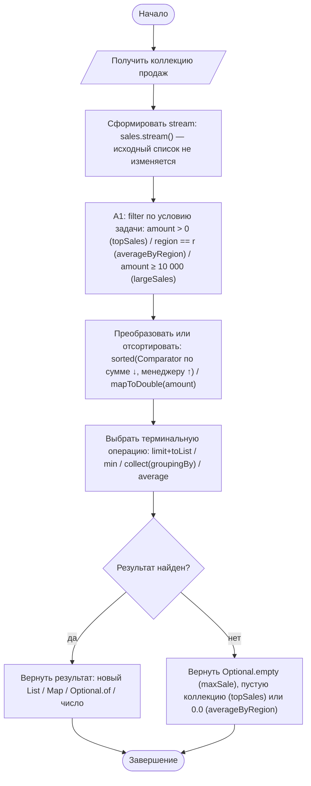
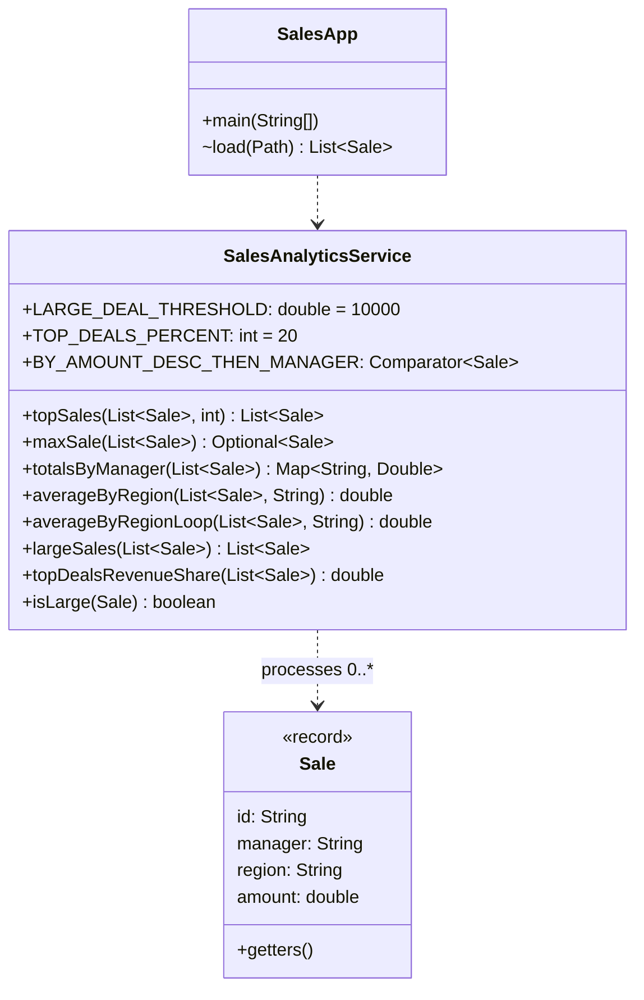

# Практическая работа №12. Stream API, Comparator, Optional и функциональная обработка коллекций

## Запуск

```bash
javac -encoding UTF-8 -d out src/*.java
java -cp out SalesApp    # аналитика по data/sample.csv (id;manager;region;amount)
java -cp out SelfCheck
```

## Индивидуальный вариант

**Вариант 3: дополнительный агрегат, модификатор 20.** Номер варианта: (58 mod 8) + 1 = 3.
Реализован агрегат `topDealsRevenueShare(list)`: **какую долю общей выручки (в %) дают 20 % крупнейших сделок** (проверка принципа Парето). Число сделок в верхней группе — `ceil(n × 20 / 100)`: из 8 сделок берутся 2, из 5 — 1, из 6 — 2. Пустой список или нулевая выручка дают 0.0. Результат округляется до сотых процента.
На открытом наборе: 2 верхние сделки (27 500 + 27 500) дают **53.66 %** выручки.
Параметр: `SalesAnalyticsService.TOP_DEALS_PERCENT`.

Порог крупной сделки (`largeSales`): сумма ≥ 10 000 ₽, константа `LARGE_DEAL_THRESHOLD`.

## Реализация

| Метод | Stream-конвейер |
|---|---|
| `topSales(list, n)` | `filter(amount > 0) → sorted(BY_AMOUNT_DESC_THEN_MANAGER) → limit(n) → toList()` |
| `maxSale(list)` | `min(BY_AMOUNT_DESC_THEN_MANAGER)` → `Optional<Sale>`; при равных суммах выбор детерминирован и совпадает с первым элементом `topSales` |
| `totalsByManager(list)` | `collect(groupingBy(manager, TreeMap::new, summingDouble(amount)))` → новый `Map` |
| `averageByRegion(list, r)` | `filter(region) → mapToDouble → average() → orElse(0.0)` |
| `largeSales(list)` | `filter(isLarge) → sorted → toList()` |
| `topDealsRevenueShare(list)` (вариант 3) | `mapToDouble(amount).sum()` — общая выручка; `sorted(BY_AMOUNT_DESC…) → limit(ceil(n·20 %)) → mapToDouble → sum()` — выручка верхней группы; доля в % |

**Comparator с двумя полями:** `comparingDouble(Sale::getAmount).reversed().thenComparing(Sale::getManager).thenComparing(Sale::getId)`. Сумма по убыванию, при равенстве — менеджер по алфавиту. `id` добавлен третьим ключом, чтобы порядок был полностью детерминирован.

## Сравнение императивного и функционального подходов

Один и тот же расчёт среднего по региону записан двумя способами (оба есть в коде, SelfCheck проверяет, что результаты совпадают):

```java
// цикл: 9 строк, две изменяемые переменные, ручная обработка пустого случая
double sum = 0; int count = 0;
for (Sale sale : sales) {
    if (sale.getRegion().equalsIgnoreCase(region)) { sum += sale.getAmount(); count++; }
}
return count == 0 ? 0.0 : sum / count;

// stream: каждая строка — один шаг, пустой случай выражен через OptionalDouble
return sales.stream()
        .filter(sale -> sale.getRegion().equalsIgnoreCase(region))
        .mapToDouble(Sale::getAmount)
        .average()
        .orElse(0.0);
```

Stream здесь читается лучше: виден конвейер «отфильтровать → взять суммы → усреднить», нет изменяемого состояния, и невозможно ошибиться с делением на ноль. Цикл уместнее там, где нужен ранний выход с побочным действием или сложное состояние между итерациями. Например, разбор CSV в `SalesApp.load` с выводом сообщений об отброшенных строках оставлен циклом.

## Activity-диаграмма (итоговая)



## Диаграмма классов (итоговая)



## Анализ фрагмента кода

```java
List<Sale> result = new ArrayList<>(); sales.stream().filter(this::isLarge).forEach(result::add);
```

Ошибка: внутри stream модифицируется внешняя `ArrayList`, а это прямо запрещено правилами работы. Конвейер перестаёт быть чистым: при `parallelStream()` `ArrayList.add` из нескольких потоков теряет элементы или бросает `ArrayIndexOutOfBoundsException`. Если `result` — поле и метод вызывается повторно, элементы накапливаются.
Исправление в `largeSales`: результат создаёт сама терминальная операция — `sales.stream().filter(this::isLarge).sorted(...).toList()`. SelfCheck проверяет, что повторный вызов даёт то же число элементов.

## Граничные проверки (результат SelfCheck: 27/27 OK)

| Проверка | Ожидание |
|---|---|
| Типовое: top-3 | `[7, 4, 1]`; при равных 27 500 Абрамов раньше Сидорова |
| Нижняя граница: `topSales(0)`, `maxSale(пустой)` | пустой список, `Optional.empty` |
| Верхняя граница: `topSales(100)` при 8 продажах | 7 (нулевая отфильтрована) |
| Агрегат варианта 3: 8 сделок / 5 сделок / 6 сделок / 1 сделка | 53.66 % / 50 % (1 верхняя) / 70 % (2 верхние, округление вверх) / 100 % |
| Агрегат варианта 3: пустой список, только нулевые суммы | 0.0 |
| Порог крупной сделки: 10 000 / 9 999,99 | крупная / нет |
| Пустое значение: регион без продаж; пустой менеджер | 0.0; IllegalArgumentException |
| Неверный формат: сумма `abc`, отрицательная сумма, `limit = −1` | строка пропущена с причиной; IllegalArgumentException |
| Повтор: повторный `largeSales`, очистка результата `totalsByManager` | результат стабилен, исходный список не изменён |

## Собственные формулировки

**Какая проверка защищает от наиболее вероятной ошибки и где она.** Чаще всего ошибаются с пустой выборкой: делят на ноль в среднем или вызывают `get()` у пустого результата. `maxSale` возвращает `Optional`, `averageByRegion` использует `OptionalDouble.orElse(0.0)`, поэтому пустой случай обрабатывается явно. Некорректная продажа не попадает в список: её отсекает компактный конструктор `Sale`.

**Где ключевое бизнес-правило и почему.** Порог крупной сделки — в `isLarge`, порядок «лучших продаж» — в константе `BY_AMOUNT_DESC_THEN_MANAGER`. Оба правила используются несколькими методами (`topSales`, `maxSale`, `largeSales`). Вынесенные в одно место, они дают согласованные результаты: максимальная продажа всегда равна первой в топе.

**Как Activity-диаграмма отражает код.** Блоки диаграммы один к одному соответствуют звеньям конвейера `topSales`: «Сформировать stream» — `sales.stream()`, A1 — `.filter(...)`, «Преобразовать или отсортировать» — `.sorted(...)`, «Терминальная операция» — `.limit(n).toList()`. Ветка «Результат не найден» — пустой список при отсутствии подходящих продаж.

**Какое изменение затронет минимум классов.** Изменение доли верхней группы (вариант) или порога крупной сделки — одна константа. Изменение вторичного поля сортировки (например, регион вместо менеджера) — одна строка в `BY_AMOUNT_DESC_THEN_MANAGER`, и это изменение согласованно повлияет и на топ, и на максимум.
