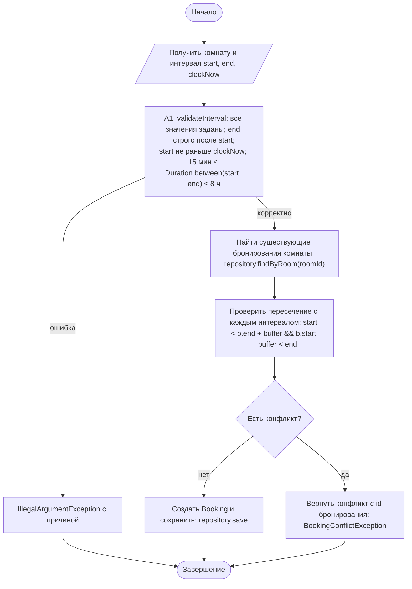
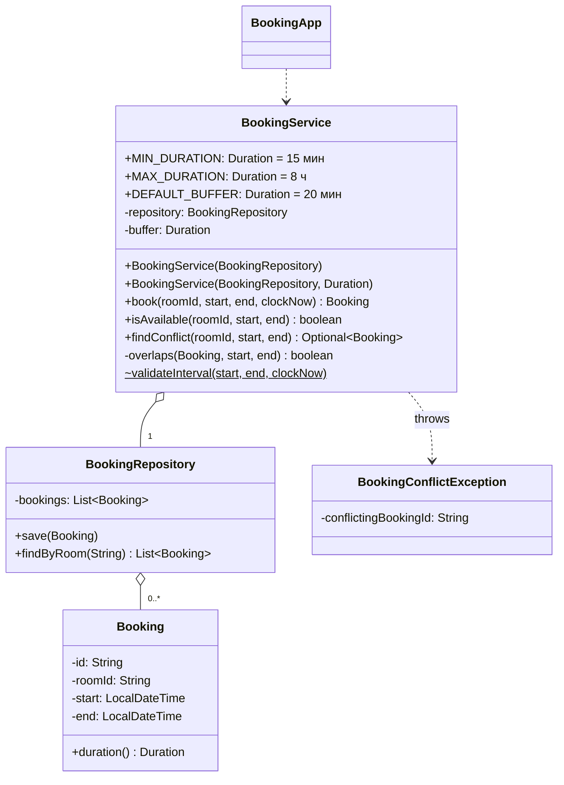

# Практическая работа №13. Date Time API и проверка пересечения интервалов

## Запуск

```bash
javac -encoding UTF-8 -d out src/*.java
java -cp out BookingApp   # заявки из data/sample.csv (room;start;end), clockNow = 2026-10-20T09:00
java -cp out SelfCheck
```

## Индивидуальный вариант

**Вариант 3: буфер между бронированиями = 20 минут.** Номер варианта: (58 mod 8) + 1 = 3.
Правило: между бронированиями **одной комнаты** должно пройти не меньше 20 минут (уборка, подготовка). После встречи 10:00–11:00 следующая может начаться не раньше 11:20: 11:20 допустимо, 11:19 и стык 11:00 — конфликт. Перед ней предыдущая должна закончиться не позже 09:40. Для разных комнат буфер не действует.
Параметр: `BookingService.DEFAULT_BUFFER`. Он передаётся в сервис через конструктор `BookingService(repository)`. Конструктор `BookingService(repository, buffer)` позволяет задать другой буфер, а `Duration.ZERO` даёт базовое правило «стык не является конфликтом» (проверено в SelfCheck отдельно).

Длительность бронирования — от 15 минут до 8 часов включительно (`MIN_DURATION`, `MAX_DURATION`).

## Правила интервала

* Бронирование — полуинтервал `[start, end)`: `end` строго позже `start`.
* Конфликт (базовая формула): `startA < endB && startB < endA`. При `endA == startB` первое условие ложно, значит без буфера стык — не конфликт.
* С буфером (вариант 3, 20 мин): `start < existing.end + buffer && existing.start − buffer < end`. Существующее бронирование расширяется на 20 минут в обе стороны, поэтому стык становится конфликтом, а начало через 20 минут — нет.
* Нельзя начать раньше переданного `clockNow`. Начало ровно в `clockNow` допустимо.

## Почему сравнение только часов и минут без даты ошибочно

Бронирования разных дней в одно и то же время (10:00–11:00 сегодня и 10:00–11:00 завтра) при сравнении `LocalTime` выглядят как конфликт, хотя не пересекаются. Бронирование через полночь 23:00–01:00 при сравнении `LocalTime` получает `end < start` и отклоняется как некорректное или ломает формулу пересечения. Поэтому везде используется `LocalDateTime`: дата и время сравниваются вместе, а переход через полночь становится обычным интервалом длиной 120 минут (проверено в SelfCheck и `sample.csv`, строки 10–11).

## Activity-диаграмма (итоговая)



## Диаграмма классов (итоговая)



## Анализ фрагмента кода

```java
boolean conflict = newStart.isBefore(oldEnd) || newEnd.isAfter(oldStart); // условие слишком широкое
```

Ошибка: используется `||` вместо `&&`. Почти любой интервал удовлетворяет хотя бы одной половине условия. Например, бронирование на завтра с 10:00 (старое — сегодня 10:00–11:00): `newEnd.isAfter(oldStart)` истинно, значит «конфликт». Бронирование на вчера: истинна первая половина. В итоге комната занята навсегда после первого бронирования.
Исправление: `start.isBefore(existing.getEnd().plus(buffer)) && existing.getStart().minus(buffer).isBefore(end)` в методе `overlaps`. Оба условия должны выполняться одновременно. При нулевом буфере строгие сравнения делают стык неконфликтным, а при буфере 20 минут (вариант 3) существующий интервал расширяется на 20 минут с каждой стороны.

## Граничные проверки (результат SelfCheck: 32/32 OK)

| Проверка | Ожидание |
|---|---|
| Типовое: 10:00–11:00 | создано, 60 мин |
| Без буфера (`Duration.ZERO`): стык 11:00–12:00 / 09:00–10:00 | не конфликт |
| Частичное, вложенное, охватывающее, совпадающее пересечение | конфликт с id существующего |
| Нижняя граница длительности: 14 / 15 мин | ошибка / OK |
| Верхняя граница: 8 ч / 8 ч 1 мин | OK / ошибка |
| `end == start`, `end < start`, начало в прошлом / ровно `clockNow` | ошибка / OK |
| Пустое значение (`null`) и неверный формат `20.10.2026 10:00` | контролируемая ошибка |
| Переход через полночь 23:00–01:00 и пересечение 00:30–02:00 | OK / конфликт |
| Буфер 20 мин (вариант 3): начало 11:00 / 11:19 / 11:20; окончание 09:41 / 09:40 | конфликт / конфликт / OK; конфликт / OK |
| Буфер через полночь: после 23:00–01:00 начало 01:10 / 01:20 | конфликт / OK |
| Буфер для другой комнаты, отрицательный буфер | не действует / IllegalArgumentException |
| `isAvailable` не меняет репозиторий | количество записей не изменилось |

## Собственные формулировки

**Какая проверка защищает от наиболее вероятной ошибки и где она.** Чаще всего путают местами начало и конец или указывают нулевую длительность. `validateInterval` первым делом проверяет `!end.isAfter(start)`, затем прошлое и длительность. Проверка выполняется до поиска конфликтов, поэтому некорректный интервал не участвует в сравнении.

**Где ключевое бизнес-правило и почему.** Формула пересечения находится в единственном методе `BookingService.overlaps`. Её используют и `isAvailable`, и `book`, поэтому проверка доступности и создание бронирования не могут разойтись в трактовке стыка или буфера.

**Как Activity-диаграмма отражает код.** A1 — `validateInterval(start, end, clockNow)`. «Найти существующие бронирования» — `repository.findByRoom(roomId)` в `findConflict`. «Проверить пересечение с каждым» — цикл `for` с вызовом `overlaps`. Ветка «да» — `throw new BookingConflictException(conflict.get())`, ветка «нет» — `new Booking(...)` и `repository.save`.

**Какое изменение затронет минимум классов.** Изменение максимальной или минимальной длительности — одна константа. Изменение буфера (вариант) — одна константа `DEFAULT_BUFFER`, формула в `overlaps` уже его учитывает.
