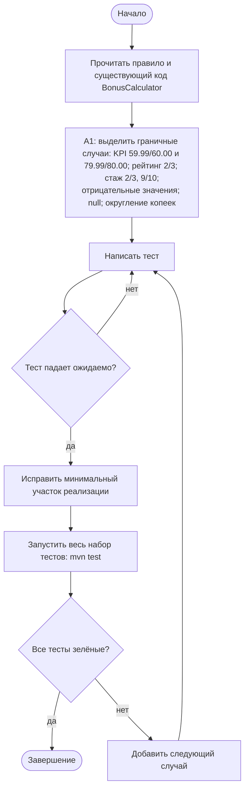
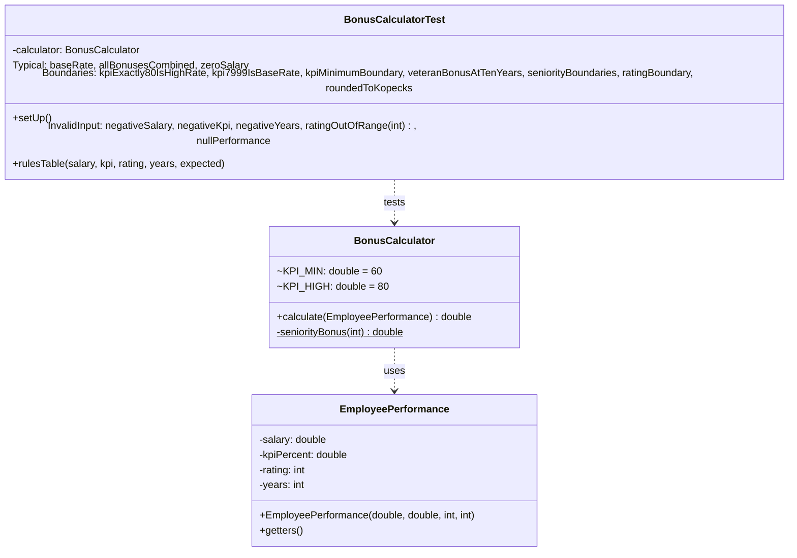

# Практическая работа №14. Автоматические тесты, Maven и проверка граничных условий

## Запуск

```bash
mvn test
```

Нужны JDK 17+ и Maven 3.9+. Результат: `Tests run: 25, Failures: 0, Errors: 0` (отчёты surefire — в `target/surefire-reports`).

## Структура Maven-проекта

```
pr14/
├── pom.xml                                  # координаты, Java 17, UTF-8, JUnit Jupiter 5.11.4 (scope test), surefire 3.5.2
├── src/main/java/ru/practice/bonus/
│   ├── BonusCalculator.java                 # расчёт премии (исправленный)
│   └── EmployeePerformance.java             # входные показатели с проверкой значений
├── src/test/java/ru/practice/bonus/
│   └── BonusCalculatorTest.java             # 25 тестов: типовые, граничные, некорректные, параметризованные
└── docs/BonusCalculator_original.java.txt   # исходная версия с дефектами (для отчёта)
```

`src/main/java` попадает в итоговый jar, `src/test/java` компилируется и запускается только на фазе `test`. Зависимость JUnit имеет `scope test`, поэтому в production-код не попадает.

## Правила расчёта премии (формализация)

| № | Правило |
|---|---|
| R1 | KPI < 60 % — премии нет (вариант 1) |
| R2 | 60 % ≤ KPI < 80 % — 10 % оклада; KPI ≥ 80 % — 20 % оклада (79.99 и 80.00 — разные правила) |
| R3 | Рейтинг 1–2 — премии нет при любом KPI; рейтинг 5 — плюс 5 п.п. |
| R4 | Стаж ≥ 3 лет — плюс 2 п.п.; стаж ≥ 10 лет — плюс 5 п.п. (вместо 2) |
| R5 | Отрицательные оклад, KPI, стаж и рейтинг вне 1..5 отклоняются `IllegalArgumentException` |
| R6 | Премия округляется до копеек |

## Индивидуальный вариант

**Вариант 1: граница KPI, модификатор 10.** Реализованное правило: нижняя граница KPI для получения премии сдвинута на 10 п.п. — **с 50 % до 60 %**. KPI 59.99 — премии нет, 60.00 — базовые 10 %.
Параметр: `BonusCalculator.KPI_MIN`.

## Найденные дефекты и тесты, которые их воспроизводят

Исходный код — в `docs/BonusCalculator_original.java.txt`. На исходной версии **10 из 25 тестов падают**, на исправленной проходят все.

| Дефект | Было | Стало | Тест |
|---|---|---|---|
| D1 | `kpi > 80`: KPI ровно 80.00 получал 10 % | `kpi >= KPI_HIGH` | `Boundaries.kpiExactly80IsHighRate`, `rulesTable[4,5]` |
| D2 | `if (years >= 3) … else if (years >= 10)`: ветка 10 лет недостижима | сначала `>= 10`, потом `>= 3` (`seniorityBonus`) | `Boundaries.veteranBonusAtTenYears`, `rulesTable[6]` |
| D3 | `null` → `NullPointerException` | явная проверка → `IllegalArgumentException` | `InvalidInput.nullPerformance` |
| D4 | `rating < 2`: рейтинг 2 получал премию | `rating < MIN_RATING_FOR_BONUS (3)` | `Boundaries.ratingBoundary`, `rulesTable[8]` |
| D5 | нет округления: `39.9996` | `Math.round(salary × rate) / 100.0` | `Boundaries.roundedToKopecks` |
| D6 | конструктор не проверял значения: отрицательный оклад → отрицательная премия | проверки в `EmployeePerformance` | `InvalidInput.negativeSalary` |

Исправления точечные: изменены условия и порядок ветвлений, добавлены проверки, а структура класса и сигнатура `calculate(EmployeePerformance)` не менялись.

## Связь бизнес-правило ↔ тестовый метод

| Правило | Тесты |
|---|---|
| R1 | `Boundaries.kpiMinimumBoundary`, `rulesTable[1,2]` |
| R2 | `Typical.baseRate`, `Boundaries.kpiExactly80IsHighRate`, `Boundaries.kpi7999IsBaseRate`, `rulesTable[3,4]` |
| R3 | `Boundaries.ratingBoundary`, `Typical.allBonusesCombined`, `rulesTable[5,7,8]` |
| R4 | `Boundaries.seniorityBoundaries`, `Boundaries.veteranBonusAtTenYears`, `rulesTable[6]` |
| R5 | `InvalidInput.negativeSalary`, `negativeKpi`, `negativeYears`, `ratingOutOfRange` (параметризованный: 0, 6, −3), `nullPerformance` |
| R6 | `Boundaries.roundedToKopecks`, `Typical.zeroSalary` |

Состав набора: 25 запусков. Отдельных тестовых методов — 16, из них граничных — 7. Параметризованных два: `rulesTable` с 8 строками `@CsvSource` и `ratingOutOfRange` с 3 строками. `assertThrows` используется в 5 методах.

**Независимость тестов.** Калькулятор создаётся заново в `@BeforeEach`, у тестов нет общих изменяемых полей и файлов, данные готовятся внутри каждого теста. Порядок запуска не влияет на результат. Тесты построены по схеме Arrange → Act → Assert (явно размечено в `Typical.baseRate`).

## Activity-диаграмма (итоговая)



## Диаграмма классов (итоговая)



## Анализ фрагмента кода

```java
if (kpiPercent > 80) { ... } // проверить, должна ли граница 80 входить в повышенный коэффициент
```

Правило работы: «79.99 и 80.00 относятся к разным правилам». Значит, 80.00 — первое значение повышенного коэффициента, и граница должна **входить**: `>= 80`. С `>` сотрудник с KPI ровно 80 % получает 10 % вместо 20 %, то есть теряет 10 % оклада. Дефект воспроизводит тест `kpiExactly80IsHighRate` (на исходном коде: `expected: <20000.0> but was: <10000.0>`). Исправление — `p.getKpiPercent() >= KPI_HIGH`.

## Собственные формулировки

**Какая проверка защищает от наиболее вероятной ошибки и где она.** Наиболее вероятная ошибка — неверная граница сравнения (`>` вместо `>=`). От неё защищают парные граничные тесты «значение на границе / на сотую меньше» в классе `Boundaries`. От некорректных данных защищают проверки в конструкторе `EmployeePerformance`: объект с отрицательным окладом просто не создаётся.

**Где ключевое бизнес-правило и почему.** Правила расчёта находятся в `BonusCalculator.calculate`, надбавка за стаж — в `seniorityBonus`. Порядок «сначала 10 лет, потом 3 года» стал явным и проверяемым отдельно. Проверка корректности значений перенесена в `EmployeePerformance`, потому что это инвариант данных, а не правило премирования.

**Как Activity-диаграмма отражает код.** Цикл «Написать тест → Тест падает ожидаемо → Исправить» буквально соответствует таблице дефектов. Для D1 сначала написан `kpiExactly80IsHighRate`, он упал на исходном коде (`was: <10000.0>`), затем исправлен один оператор, и `mvn test` прогнал весь набор.

**Какое изменение затронет минимум классов.** Изменение границы KPI или коэффициентов — одна константа в `BonusCalculator` и одна-две строки ожидаемых значений в `rulesTable`.
