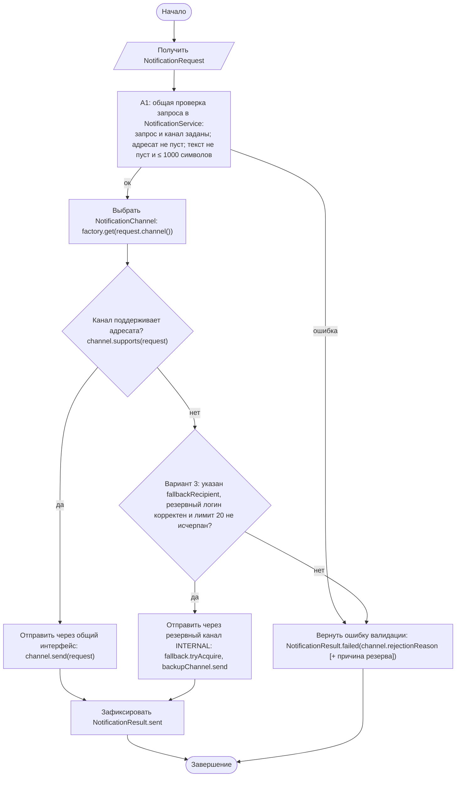
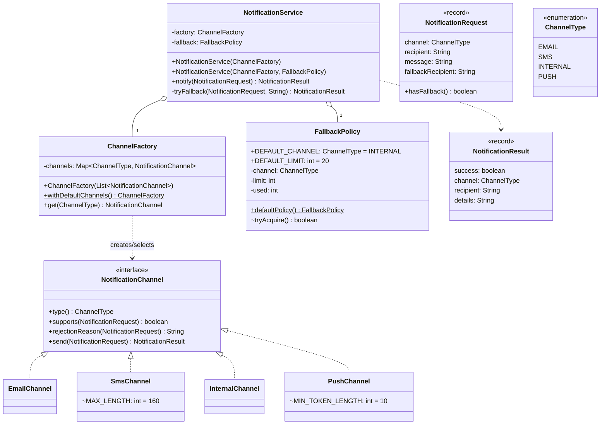

# Практическая работа №15. Базовые паттерны проектирования на прикладной задаче

## Запуск

```bash
javac -encoding UTF-8 -d out src/*.java
java -cp out NotificationApp   # уведомления из data/sample.csv (channel;recipient;fallbackLogin;message)
java -cp out SelfCheck
```

## Применённые паттерны

| Паттерн / принцип | Где | Что даёт |
|---|---|---|
| **Strategy** | `NotificationChannel` и реализации `EmailChannel`, `SmsChannel`, `InternalChannel`, `PushChannel` | алгоритм отправки и проверки адресата выбирается во время выполнения |
| **Factory (упрощённый Factory Method)** | `ChannelFactory.get(ChannelType)` и `withDefaultChannels()` | выбор реализации в одном месте; фабрика не отправляет сообщения |
| **Dependency Injection через конструктор** | `new NotificationService(ChannelFactory)` | сервис не создаёт каналы сам; в тесте подставляется фабрика с фиктивным каналом |
| **Open/Closed** | новый канал = новый класс | `NotificationService` и существующие каналы не меняются |
| Отказ от `instanceof`/`switch` | `NotificationService.notify` | только полиморфные вызовы `supports` / `send` |

## Индивидуальный вариант

**Вариант 3: политика резервного канала, модификатор 20.** Номер варианта: (58 mod 8) + 1 = 3.
Реализованное правило (класс `FallbackPolicy`):
1. Если основной канал отклонил запрос (`supports` = false) и в запросе указан резервный адресат (`fallbackRecipient` — логин сотрудника), уведомление отправляется через **резервный канал INTERNAL**. Результат помечается «через резервный канал (… отказал: причина)».
2. Резервных отправок — **не более 20** на экземпляр сервиса. Это защита от лавины: при массовом сбое основного канала внутренний ящик не заваливается. 20-я резервная отправка проходит, 21-я — отказ «лимит резервных отправок (20) исчерпан».
3. Резерв не используется, если не прошла общая проверка запроса (пустой текст и т. п.), если основной канал сам INTERNAL или если резервный логин некорректен (тогда в отказе указаны обе причины).

Параметры: `FallbackPolicy.DEFAULT_LIMIT` (20) и `FallbackPolicy.DEFAULT_CHANNEL` (INTERNAL). Политика передаётся в `NotificationService` через конструктор, как и фабрика. Существующие классы каналов не изменялись.

**Добавленный канал (шаг 5)** — PUSH (`PushChannel`): токен устройства из латинских букв и цифр длиной не менее 10 символов. Для подключения нужны новый класс, константа `PUSH` в `ChannelType` и одна строка в `ChannelFactory.withDefaultChannels()`.

## Правила адресатов (валидация внутри своего канала)

| Канал | Правило |
|---|---|
| EMAIL | один `@`, непустое имя, домен с точкой |
| SMS | `+7` и 10 цифр; текст ≤ 160 символов |
| INTERNAL | логин `[a-z0-9._-]{3,32}` |
| PUSH | токен `[A-Za-z0-9]`, длина ≥ 10 |

Общие правила для всех каналов (адресат и текст не пусты, текст ≤ 1000 символов) проверяет `NotificationService` (блок A1).

## Activity-диаграмма (итоговая)



## Диаграмма классов (итоговая)



По сравнению с исходной диаграммой в интерфейс добавлен `rejectionReason(...)`. Каждый канал сам объясняет, почему адресат не подходит, и сервису не нужно знать правила каналов, чтобы сформировать понятный отказ. Также добавлен `type()` для регистрации в фабрике без `switch`.

## Анализ фрагмента кода

```java
switch (type) { case EMAIL -> new EmailSender().send(...); case SMS -> new SmsSender().send(...); }
```

Ошибки:
1. Сервис знает все конкретные классы и сам создаёт их через `new`. Подменить отправителя в тесте нельзя: каждый тест будет «реально» отправлять письма.
2. Новый канал требует правки этого `switch`, а если такие `switch` есть в нескольких местах, то правки каждого из них. Это нарушение Open/Closed.
3. Проверка адресата либо отсутствует, либо будет размазана по веткам того же метода. Канала INTERNAL в `switch` нет — такое сообщение молча не отправится.

Исправление: `NotificationService` получает `ChannelFactory` через конструктор и вызывает `channel.supports(...)`/`channel.send(...)` через интерфейс. В `SelfCheck` сервис проверяется с фиктивным каналом `RecordingChannel`.

## Какие изменения стали локальными

| Изменение | Затрагивает |
|---|---|
| Новый канал (PUSH, шаг 5) | новый класс + константа enum + строка в `withDefaultChannels` |
| Правило адресата одного канала (например, SMS-лимит 70 символов для кириллицы) | только класс этого канала |
| Общий лимит длины сообщения | только `NotificationService.MAX_MESSAGE_LENGTH` |
| Реальная интеграция с SMTP | только `EmailChannel.send` |
| Тестирование сервиса | фиктивная реализация интерфейса, без изменения production-кода |

## Граничные проверки (результат SelfCheck: 33/33 OK)

| Проверка | Ожидание |
|---|---|
| Типовые: email, sms, internal, push | ОТПРАВЛЕНО |
| Нижние границы: логин 2 символа, токен 9 символов | отказ |
| Верхние границы: SMS 160 / 161 символ, сообщение 1001 символ | OK / отказ / отказ |
| Пустые значения: адресат, текст, канал `null`, запрос `null` | отказ с причиной |
| Неверный формат: email без `@` / без точки / два `@`; номер `8916…`; кириллический логин; `FAX` | отказ / IllegalArgumentException |
| Конфликт: канал зарегистрирован дважды; канал не подключён | IllegalArgumentException |
| Фиктивный канал: `send` вызван ровно один раз; при ошибке A1 не вызван | OK |
| Резервный канал (вариант 3): SMS `8916…` + логин `p.sidorov` | доставлено через INTERNAL |
| Резерв: без логина / с кириллическим логином / основной канал принял / пустой текст | отказ основного / отказ с двумя причинами / резерв не используется / отказ без резерва |
| Лимит резерва: 21 запрос с отказом основного канала | 20 доставлено, 21-й — отказ «лимит исчерпан» |

## Собственные формулировки

**Какая проверка защищает от наиболее вероятной ошибки и где она.** Чаще всего ошибаются в формате адресата для выбранного канала: телефон с `8`, email без домена. Эту проверку выполняет `supports(...)` в классе конкретного канала. Правило лежит рядом с кодом отправки, которому оно нужно, и не теряется при добавлении каналов.

**Где ключевое бизнес-правило и почему.** Правило «сначала общие проверки, затем проверка канала, затем отправка» находится в `NotificationService.notify`, и это единственная логика сервиса. Правила адресатов — в каналах. Сервис не знает деталей, как требует задание.

**Как Activity-диаграмма отражает код.** A1 — `commonValidationError(request)`. «Выбрать NotificationChannel» — `factory.get(request.channel())`. Ромб — `if (!channel.supports(request))`. Ветка «нет» — `NotificationResult.failed(..., channel.rejectionReason(request))`, ветка «да» — `channel.send(request)`.

**Какое изменение затронет минимум классов.** Изменение правила адресата одного канала — только класс этого канала. Изменение лимита или канала резерва (вариант) — константы `FallbackPolicy.DEFAULT_LIMIT` / `DEFAULT_CHANNEL`, а для тестов — другой объект политики в конструкторе сервиса.
