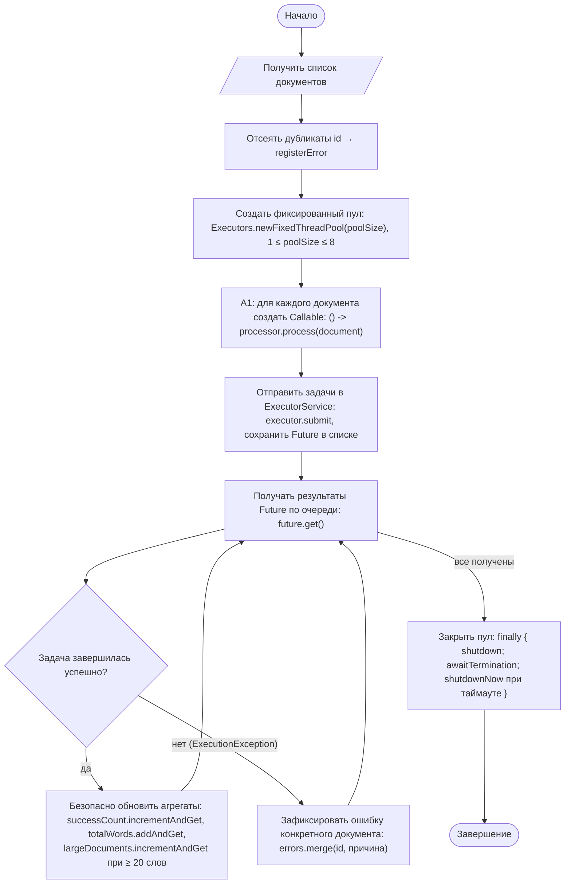
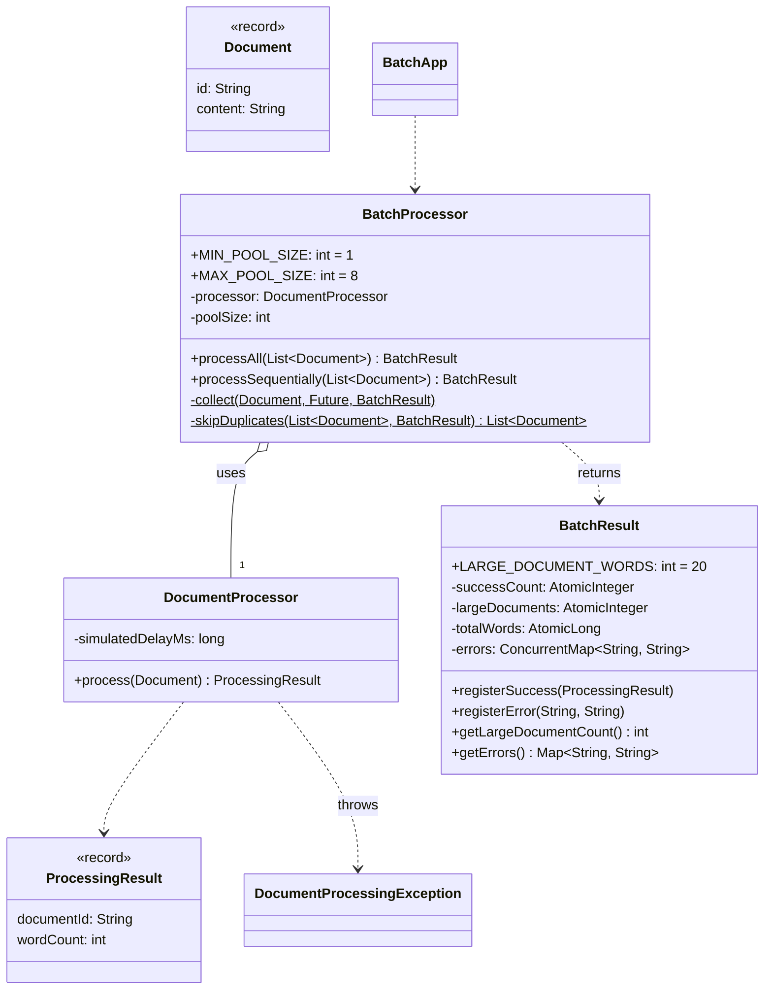

# Практическая работа №16. Параллельное выполнение задач и безопасная агрегация результатов

## Запуск

```bash
javac -encoding UTF-8 -d out src/*.java
java -cp out BatchApp          # пул 4, задержка 100 мс на документ, data/sample.csv
java -cp out BatchApp 8 100    # [размер пула] [задержка мс]
java -cp out SelfCheck
```

## Индивидуальный вариант

**Вариант 3: дополнительный агрегат, модификатор 20.** Номер варианта: (58 mod 8) + 1 = 3.
Реализован агрегат **«число объёмных документов»**: успешно обработанные документы, в которых **не менее 20 слов**. 19 слов не учитываются, 20 и 21 учитываются, документы с ошибкой не учитываются. Счётчик — `AtomicInteger` в `BatchResult` (`getLargeDocumentCount()`), обновляется в `registerSuccess` так же потокобезопасно, как и остальные агрегаты. Результат одинаков при любом размере пула.
Параметр: `BatchResult.LARGE_DOCUMENT_WORDS`.

Допустимый размер пула — от 1 до 8 (`BatchProcessor.MIN_POOL_SIZE`/`MAX_POOL_SIZE`).

## Сравнение времени (пример запуска на тестовом наборе)

21 документ, имитация обработки 100 мс:

| Режим | Результат | Время |
|---|---|---|
| Последовательный | успешно 17, ошибок 4, слов 324, документов от 20 слов 11 | ≈ 2094 мс |
| Пул из 4 потоков | успешно 17, ошибок 4, слов 324, документов от 20 слов 11 | ≈ 536 мс |

Агрегаты совпадают, время сократилось примерно в 4 раза: 20 уникальных документов по 100 мс = 2 с, а 4 потока × 5 волн ≈ 0,5 с. **Это не гарантия ускорения.** Результат зависит от числа ядер, характера нагрузки (здесь `sleep` имитирует ожидание ввода-вывода, а не вычисления), накладных расходов на создание пула и распределения длительностей задач. Для CPU-нагрузки ускорение ограничено числом ядер, а на маленьком наборе пул может оказаться медленнее последовательного цикла.

## Activity-диаграмма (итоговая)



## Диаграмма классов (итоговая)



`ExecutorService` не хранится полем: пул создаётся на один вызов `processAll` и закрывается в его `finally`. Пул не «утекает», если объект `BatchProcessor` забыли закрыть, а повторный вызов `processAll` получает новый пул.

## Анализ фрагмента кода

```java
for (Document d : docs) { new Thread(() -> process(d)).start(); } // неограниченное создание потоков и отсутствие ожидания результата
```

Ошибки:
1. На каждый документ создаётся отдельный поток. На 100 000 документов это 100 000 потоков: исчерпание памяти (`OutOfMemoryError: unable to create native thread`) и деградация из-за переключения контекста.
2. Нет ожидания: метод возвращается сразу, результаты и ошибки потеряны, итоговые счётчики читаются до завершения обработки.
3. Исключение в потоке просто печатается в stderr, и нельзя узнать, какой документ не обработан.
4. Если `process` увеличивает общий счётчик через `count++`, при параллельном выполнении часть инкрементов теряется. `count++` — это три операции (прочитать, прибавить, записать), а не одна атомарная.

Исправление: фиксированный пул `poolSize` потоков, по одному `Callable` на документ, ожидание каждого `Future.get()` с локализацией `ExecutionException`. Счётчики — `AtomicInteger`/`AtomicLong`, ошибки — `ConcurrentHashMap`. Пул гарантированно закрывается в `finally`.

## Граничные проверки (результат SelfCheck: 16/16 OK)

| Проверка | Ожидание |
|---|---|
| Типовое: 50 документов, пулы 1, 3, 8 | всегда 45 успешных, 5 ошибок, 1125 слов, 27 документов от 20 слов (детерминированно) |
| Агрегат варианта 3: 19 / 20 / 21 слово, пустой документ | не учитывается / учитывается / учитывается / не учитывается |
| Последовательный режим | те же агрегаты |
| Нижняя/верхняя граница пула: 0 / 1 / 8 / 9 | ошибка / OK / OK / ошибка |
| Пустое значение: пустой документ, пустой список, `null`-список, пустой id | ошибка документа / нули / IllegalArgumentException |
| Неверный формат: документ с `#CORRUPTED` | ошибка этого документа, остальные обработаны |
| Повтор: два документа с одним id | первый обработан, второй — ошибка «дубликат» |
| Закрытие пула | после `processAll` число активных потоков не выросло |

## Собственные формулировки

**Какая проверка защищает от наиболее вероятной ошибки и где она.** Самая вероятная ошибка — исключение в одном документе, которое обрывает всю обработку или теряется. `catch (ExecutionException e)` в `BatchProcessor.collect` перехватывает ошибку ровно одной задачи и записывает её с id документа. Цикл по `Future` продолжается.

**Где ключевое бизнес-правило и почему.** Правило «счётчики детерминированы при любом порядке завершения» обеспечено в `BatchResult`: атомарные операции `incrementAndGet`/`addAndGet` и `ConcurrentHashMap.merge`. Агрегаты потокобезопасны независимо от того, кто их вызывает: сейчас поток-сборщик, но можно и сами задачи. Вычисление (`DocumentProcessor`) отделено от агрегации и не имеет общего состояния.

**Как Activity-диаграмма отражает код.** A1 — лямбда `() -> processor.process(document)`, присвоенная `Callable<ProcessingResult>`. «Получать результаты Future» — цикл `for` по `futures` с вызовом `collect`. Ромб «Задача завершилась успешно» — `try { future.get() } catch (ExecutionException e)`. «Закрыть пул» — блок `finally` с `shutdown()`.

**Какое изменение затронет минимум классов.** Изменение допустимого размера пула — одна константа `MAX_POOL_SIZE`. Изменение условия ошибки документа — только `DocumentProcessor.process`. Изменение порога «объёмного» документа (вариант) — одна константа `BatchResult.LARGE_DOCUMENT_WORDS`. Новый агрегат — одно атомарное поле и строка в `registerSuccess` класса `BatchResult`, как сделано для агрегата варианта 3.
